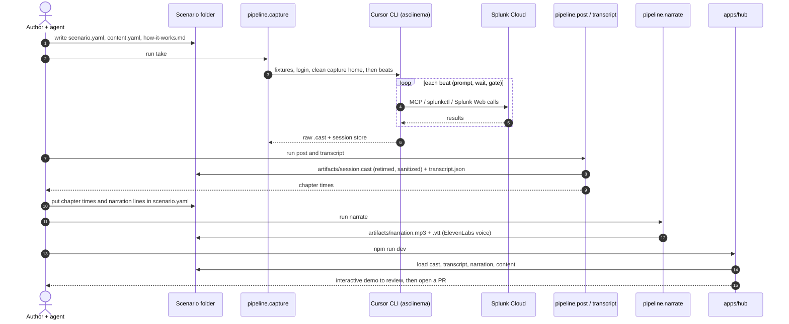

# Headless Splunk demos

Interactive demo pages built from **real AI-client sessions against Splunk Cloud**. A coding agent records a session
(Cursor CLI or GitHub Copilot CLI), the pipeline cleans and retimes it, adds a transcript and a voice-over, and a small web app (the
hub) plays it with approval gates, chapters, and a "how it works" panel. You author demos by working with an agent
(Claude Code, Cursor, Codex, or GitHub Copilot) that follows the repo's `demo-author` skill.

Design: [docs/demo_pipeline_architecture.md](docs/demo_pipeline_architecture.md) · Use cases:
[docs/headless_use_case_matrix.md](docs/headless_use_case_matrix.md)

> **Status: MVP.** Capture runs locally on macOS and the hub is published as a static Cloudflare Worker. Cloud
> capture, CI, and Sanity are planned, not built (architecture doc §8–13). Authoring works end to end today.

## How a demo is made



`scenario.yaml` drives recording and narration; `content.yaml` and `how-it-works.md` are text visitors read and never
need a new capture. Chapter IDs must match in both. Everything under `scenarios/<id>/artifacts/` is generated.

## Repo layout

| Path | What it holds |
|---|---|
| `.agents/skills/demo-author/` | The authoring skill every agent follows (rules, steps, narration guide, lessons learned) |
| `AGENTS.md`, `CLAUDE.md` | Agent instructions (`CLAUDE.md` just imports `AGENTS.md`) |
| `scenarios/<id>/` | One demo: `scenario.yaml`, `content.yaml`, `how-it-works.md`, `fixtures/`, `artifacts/` |
| `pipeline/` | Python steps: `capture`, `post`, `transcript`, `narrate` (+ `sanitize`, `workflow`, client adapter) |
| `recorder/` | Capture-home config: client templates and gated wrappers, `hints/`, `voice.yaml` (house voice) |
| `scripts/` | Capture environment (`ce01_capture.py`), stack profiles, data seeders, screenshot/login helpers, `doctor.py` |
| `apps/hub/` | Vite + React + Tailwind app that plays the demos; CI deploys it on every push to `main` |
| `docs/` | Architecture and use-case matrix (other files are local notes and git-ignored) |
| `.captures/` | Raw takes, secrets, Python venv. **Git-ignored; never commit from it** |

Demos today: CE-01, CE-03, CE-08, EB-03, SO-07, SO-08 are captured. IR-02, PO-06, SO-03 are defined but not yet
recorded (`source: metadata`).

## Where demos are hosted

The whole catalog is **one static Cloudflare Worker** named `headless-splunk-demos` ([apps/hub/wrangler.jsonc](apps/hub/wrangler.jsonc)).
There is no backend, database, or runtime secret: visitors only download files.

| | |
|---|---|
| Live URL | `https://splk.headless.colide.ai` (custom domain); also on `workers.dev` |
| App | A single-page Vite + React app. All demos live on one page with a catalog and filters; there is no per-demo URL yet |
| Content | Baked into the build. Vite reads every `scenarios/*/` folder (`scenario.yaml`, `content.yaml`, `how-it-works.md`, `artifacts/*`) and bundles it with content-hash file names. Adding a scenario folder adds a demo to the catalog |
| Catalog control | `display` in `content.yaml`: `hidden` removes a demo from the catalog, `featured` picks the default one, `order` sorts it |
| Audio | `narration.mp3` ships as a static asset. The hub fetches it and plays it from a Blob URL, because Workers static assets don't support the `Range` requests Safari needs |
| n8n canvas | Demos that draw a workflow (SO-08) serve a frozen n8n editor from `apps/hub/public/n8n-preview/` (~30 MB, generated, git-ignored) |
| Deploy | GitHub Actions deploys every push to `main` that passes the tests (see below). Manual fallback for the owner: `cd apps/hub && npm run deploy` (needs `wrangler login`). App and demos ship as one version, so a rollback restores both |
| Observability | Worker logs and traces are on in `wrangler.jsonc` |

```text
git push ──► GitHub Actions: test ──► (main only) wrangler deploy ──► Cloudflare Worker ──► visitors
```

You never need Cloudflare access to author: `npm run dev` in `apps/hub` shows exactly what will ship. Planned, not
built yet (architecture doc §8–13): R2 for video and audio, Analytics Engine, Sanity editing, and CI recapture.

### CI/CD

[.github/workflows/ci.yml](.github/workflows/ci.yml) runs on every push. Capture never runs in CI (it needs a Splunk
stack, macOS, and a signed-in client); CI checks and ships what is committed.

1. **Test** (every branch): `pipeline.narrate --check` for each recorded scenario (audio and captions match the text,
   chapter times, and voice), hub lint and type-check, the n8n canvas snapshot (cached, rebuilt with Docker when its
   inputs change), and `npm run build` (this validates every scenario's content and chapter IDs). The workflow-canvas
   browser check against the hub's fixture scenario runs only when `apps/hub/` or the n8n snapshot inputs changed, so a
   push that only touches demos skips it.
2. **Deploy** (`main` only, after a green test): deploys the exact build that was tested with `wrangler deploy`, then
   checks that the live site and the n8n canvas answer. Deploys run one at a time.

Open a PR from a branch, let CI go green, and merge: the merge deploys. One-time setup for the repo owner: create a
Cloudflare API token from the **Edit Cloudflare Workers** template (include the zone of the custom domain) and add it,
with the account ID, under *Settings → Secrets and variables → Actions*:

```sh
gh secret set CLOUDFLARE_API_TOKEN
gh secret set CLOUDFLARE_ACCOUNT_ID
```

Optionally protect `main` (require the `test` check) and add required reviewers to the `production` environment.


Capture needs macOS. Narration, editing text, and the hub work anywhere the tools below install.

**1. Tools** (Homebrew)

```sh
brew install uv node ffmpeg asciinema gitleaks zellij
brew install elevenlabs/tap/elevenlabs        # then: elevenlabs auth login
npm install -g @playwright/cli                # browser checks inside the recorded session
curl https://cursor.com/install -fsS | bash   # Cursor CLI (the default recorded client); then: agent login
brew install --cask copilot-cli               # GitHub Copilot CLI, for demos with client.name: copilot-cli (SO-03)
```

`splunkctl` ([releases](https://github.com/splunk/splunkctl/releases)) must be at `/usr/local/bin/splunkctl`; on macOS run
`xattr -d com.apple.quarantine` on the binary. Optional: Docker (the n8n canvas snapshot), `acli` (Jira demo SO-07).

**2. Clone and install**

```sh
git clone https://github.com/NikitaVoitov/cli_demos.git && cd cli_demos
uv venv --python 3.12 .captures/venv        # the pipeline needs Python 3.10+; macOS's system Python is too old
uv pip install --python .captures/venv/bin/python -r pipeline/requirements.txt
(cd apps/hub && npm ci)
cp .env.example .env                        # fill in only what your demo needs
python3 scripts/doctor.py --capture         # lists anything still missing, with the fix
```

**3. Skills**

| Skill | Used by | How you get it |
|---|---|---|
| `demo-author` | **You and your agent**, to author demos | In the repo. Cursor, Codex, and Copilot discover `.agents/skills/` on their own; Claude Code reads it because `AGENTS.md` says so |
| `splunkctl`, `playwright-cli` | The **recorded** client | `playwright-cli install --skills agents --global` once; capture setup copies both into the capture home (`splunkctl` from its binary) |
| Splunk Agent Skills ([splunk/splunk-agent-skills](https://github.com/splunk/splunk-agent-skills), 32 skills) | The **recorded** client | Capture setup installs `search-and-dashboard-troubleshooter`; add more per demo with `recording.skills: [splunk-search]` in `scenario.yaml` |
| Same Splunk skills, optional | Your **authoring** agent, to read what a skill does | `npx skills add splunk/splunk-agent-skills --skill '*' --agent <claude-code\|cursor\|codex\|github-copilot> --copy --yes` |
| `react-vite-best-practices`, optional | Hub UI work only | `npx skills add AsyrafHussin/agent-skills --skill react-vite-best-practices --agent <agent>` |

The rest of `.agents/skills/` on the owner's machine (BMAD) is local tooling, not part of the workflow or the repo.

**4. Check it works.** No stack needed:

```sh
.captures/venv/bin/python -m pipeline.narrate scenarios/ce-01-dashboard --check   # "narration is current"
```

To see the hub, build the n8n canvas snapshot once (SO-08 draws a workflow, and the hub refuses to build without it;
needs Docker, ~30 MB, git-ignored), then run it:

```sh
.captures/venv/bin/python scripts/n8n_preview_snapshot.py
cd apps/hub && npm run dev
```

## Author a demo with an agent

Open the repo in your agent and ask, for example: *"Using the demo-author skill, build a demo for use case PO-06 from the
matrix."* The agent copies the shape of an existing scenario, writes `scenario.yaml`, `content.yaml`, and
`how-it-works.md`, and runs the steps below. Review the result in the hub and open a pull request.

```sh
.captures/venv/bin/python -m pipeline.capture    scenarios/<id> <take>    # real run; a person can watch
.captures/venv/bin/python -m pipeline.post       scenarios/<id> <take>    # retime + sanitize → session.cast; prints chapter times
.captures/venv/bin/python -m pipeline.transcript scenarios/<id> --store .captures/<id>/<take>/session/<store.db or events.jsonl>
.captures/venv/bin/python -m pipeline.narrate    scenarios/<id> --estimate   # free timing check, then without --estimate
.captures/venv/bin/python -m pipeline.narrate    scenarios/<id> --check
```

Use `pipeline.capture ... --plan` to print what a take would do without touching a stack. Details, narration rules,
and pitfalls from earlier demos are in the skill; read it before your first demo.

### Recording against a Splunk stack

Authoring text and narration needs no stack. A take needs one, plus your IP on the stack's allowlist (`search-api` for
splunkctl, `search-ui` for Splunk Web and the MCP Server). Two ways to point the capture at it:

- **Your own stack (recommended):** put `SPLUNK_WEB_BASE_<NAME>`, `SPLUNK_REST_URL_<NAME>`, `SPLUNK_REST_TOKEN_<NAME>`,
  and `SPLUNK_MCP_TOKEN_<NAME>` in `.env`, run `.captures/venv/bin/python scripts/stack_profile.py init <name>`, then set
  `recording.stackProfile: <name>` in the scenario.
- **The shared default stack:** `~/.splunkctl/config.yaml`, `~/.cursor/mcp-secrets/splunk-mcp.env`
  (`SPLUNK_MCP_AUTH="Bearer <token>"`), and `.captures/ce01/secrets/web_base`. Ask the owner for access.

First capture on a machine: run `.captures/venv/bin/python scripts/ce01_capture.py setup`, then `... login` (signs Cursor
CLI in inside the neutral capture home at `/Users/Shared/splunk-demo`), then `setup` again to pin its settings.

### Recording with GitHub Copilot CLI

A scenario with `client: { name: copilot-cli, label: GitHub Copilot }` is recorded with Copilot CLI instead of Cursor
(SO-03 is the first). The capture builds `~/.copilot/` in the capture home and a `copilot` launcher in its `bin/` with
the flags every take uses ([recorder/clients/copilot-cli/copilot.tmpl](recorder/clients/copilot-cli/copilot.tmpl)).
Once per machine, sign Copilot in inside the capture home with the GitHub account that has your Copilot seat:

```sh
CAPTURE_CLIENT=copilot-cli .captures/venv/bin/python scripts/ce01_capture.py setup
CAPTURE_CLIENT=copilot-cli .captures/venv/bin/python scripts/ce01_capture.py login
```

The sign-in token goes to the login keychain, which the capture home shares. A corporate network can block one Copilot
API host and not another (here `api.individual.githubcopilot.com` was reset while `api.business.githubcopilot.com`
answered), so sign in with the business account if the personal one fails with "Failed to load models".

For a dry run without the Copilot service, point the take at your own model: any `COPILOT_PROVIDER_*`, `COPILOT_MODEL`,
or `COPILOT_OFFLINE` variable in your environment passes through to the capture shell (`copilot help providers-env`).
Never publish such a take: the model's name shows in Copilot's footer.

### Jupyter notebook tooling

The recorder's [notebook requirements](recorder/notebook/requirements.txt) include JupyterLab, real-time collaboration,
and Datalayer's [Jupyter MCP Server](https://github.com/datalayer/jupyter-mcp-server) and
[MCP Tools extension](https://github.com/datalayer/jupyter-mcp-tools). The `notebook` capture setup installs them in
`/Users/Shared/splunk-demo/nb`. To refresh an existing notebook environment after requirements change:

```sh
uv pip install --python /Users/Shared/splunk-demo/nb/bin/python -r recorder/notebook/requirements.txt
```

For authoring, run JupyterLab on loopback with token authentication and configure your MCP client to launch
`jupyter-mcp-server` over stdio with `JUPYTER_URL` and `JUPYTER_TOKEN`. Keep tokens in private, untracked configuration.
The MCP Tools frontend commands require an open JupyterLab browser tab.

These packages do not automatically add MCP access to the recorded client: arbitrary notebook execution could bypass
the gated `jpterm` wrapper. Recorded demos continue to use that wrapper and its existing approvals.

## Rules

- No secrets, usernames, IPs, or real stack hostnames in anything committed. SaaS demos use a personal or demo tenant.
- Never edit `artifacts/` by hand, and never commit from `.captures/`.
- Don't push to `main` or write to Sanity. Open a PR; the owner reviews it, and merging to `main` deploys through CI.
- After changing narration lines, chapter times, or the voice, rerun `pipeline.narrate` and commit its outputs.
