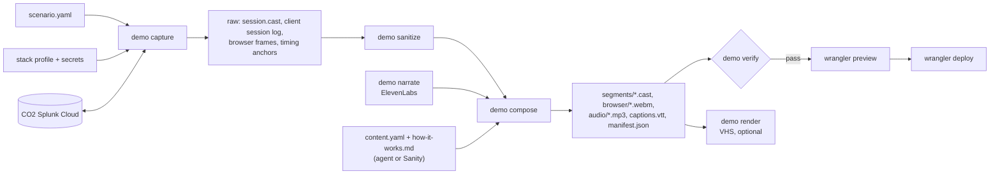
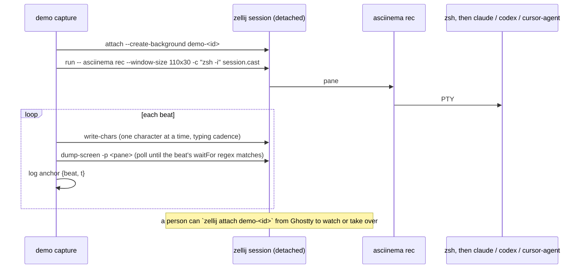
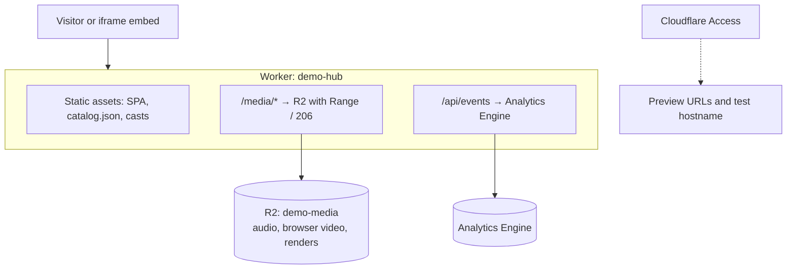
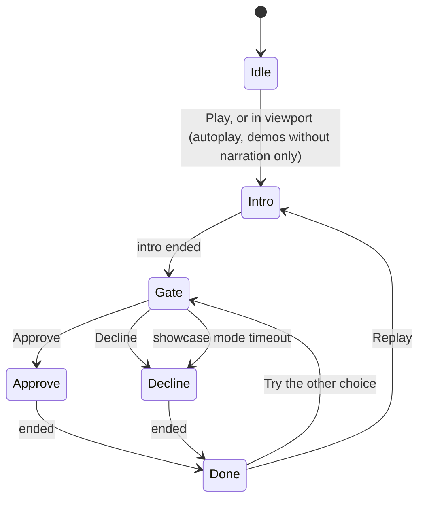
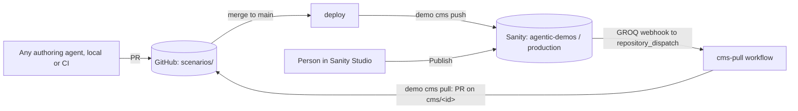

# Demo Pipeline Architecture

Status: MVP scope agreed, November 16, 2026. Nothing is scaffolded yet. Use cases come from [`headless_use_case_matrix.md`](headless_use_case_matrix.md).

This document describes how a demo goes from a use-case row to an interactive page. The first implementation is the deliberately narrow, local-first CE-01 MVP in [§0](#0-mvp-stage-ce-01-feedback-prototype). Sections 1–13 describe the target architecture after that MVP has been tested with users; they are not all prerequisites for the first prototype.

In the target architecture, a coding agent authors, records, and publishes the demo, and a person reviews it. The pipeline doesn't depend on which agent that is: Cursor, Claude Code, Codex, GitHub Copilot, or any other agent that can run shell commands and open a pull request ([§11.1](#111-authoring-agents)). A person can also edit demo text and media in Sanity Studio, and those edits come back to the repo as pull requests ([§10](#10-content-editing-sanity)); Sanity is explicitly out of scope for the MVP. Each demo shows the real AI client a visitor already uses (Claude Code, Codex, Cursor CLI) working against a real Splunk Cloud stack, optionally alongside Splunk Web, as one synced story. The authoring agent and the recorded client are independent: a demo written by Copilot can record Claude Code.

## 0. MVP stage: CE-01 feedback prototype

### 0.1 Goal and success criterion

The MVP tests one product question, not the full automation platform:

> Does a real Cursor CLI session that discovers data, builds a Dashboard Studio dashboard on the CO2 Splunk Cloud stack, asks before deploying it, and proves that it renders make a convincing, understandable, and reusable demo?

The only real demo is [CE-01](headless_use_case_matrix.md#34-content-authoring--lifecycle): **Build a dashboard from a prompt: discover data, draft SPL, generate Studio JSON, deploy, check it renders.** It uses Cursor CLI as both the authoring and recorded agent, the local machine as the recorder, and the existing CO2 stack. The formats stay client-neutral, but the MVP has no client adapter layer and proves no other agent.

The MVP is complete when:

- The recording is a real Cursor CLI run against CO2, not a scripted imitation.
- Cursor discovers the sample data, validates SPL, writes a Dashboard Studio JSON artifact, receives `CONFIRMATION_REQUIRED`, deploys only after approval, and verifies the rendered dashboard.
- The local app pauses at the approval gate, resumes on **Approve**, and stops without showing the write on **Decline**.
- The final Splunk Web pane is a real screenshot of that deployed dashboard.
- Filters, category counts, facets, the use-case list and collapsed rail, progress, Transcript, and How it works behave as described below and stay visually close to the current mockups.
- The cast, transcript, screenshot, dashboard JSON, and page expose no token, username, IP, or real stack hostname.
- A person can run and review the complete prototype locally. Cloudflare deployment happens only after the owner approves the local result.

### 0.2 What is deliberately simplified

The MVP tests a thin end-to-end path:

```text
CE-01 files → manual local Cursor run → asciinema cast + dashboard screenshot
            → small sanitization/build step → local Vite app → user review
            → owner approval → static Cloudflare deployment
```

It does **not** implement:

- Sanity or any CMS sync.
- Automated zellij driving, typed-key cadence, `waitFor` polling, retries, or CI capture.
- Multi-client adapters or tests with Claude Code, Codex, or Copilot.
- Cursor session-log parsing or automatic Commands/Transcript generation.
- Two independently recorded approval branches.
- Browser video, CDP screencasting, rrweb, frame synchronization, or focus-track derivation.
- General retiming/composition, multiple cast segments, crossfades, or narration.
- R2, Analytics Engine, Navattic, VHS, MP4/GIF distribution, embeds, or production automation.
- `demo new`, CMS subcommands, stage caching, or a generalized command framework.

These remain target capabilities in the later sections. They move into implementation only when user feedback or a second demo proves that they are needed.

### 0.3 MVP artifacts and content model

Keep the scenario/content split and stable chapter and callout IDs because they cost little, support text-only edits, and avoid a later migration when Sanity is added. Hand-author the files for CE-01; do not build scaffolding commands yet.

```text
scenarios/ce-01-dashboard/
  scenario.yaml                     # client, stack label, artifact paths, stable IDs and timestamps
  content.yaml                      # catalog metadata and all visitor-facing labels and copy
  how-it-works.md
  artifacts/
    session.cast                    # one approved Cursor CLI run
    transcript.json                 # hand-authored structured transcript from the real run
    checkout_latency.json           # the dashboard Cursor produced
    dashboard.png                   # real post-deploy Splunk Web screenshot
```

`scenario.yaml` needs only:

- `id`, `useCase`, `client`, `stack`, terminal size, and capture evidence.
- One cast path and its duration.
- Stable chapter IDs and manually reviewed timestamps: `prompt`, `draft-spl`, `approval`, `deploy`, `render-check`.
- One gate timestamp and the blocked `dashboard add` command.
- The dashboard artifact and screenshot paths.

`content.yaml` holds the title, summary, category, Agent/Technology/Splunk facets, chapter labels, gate copy, and short callouts. `how-it-works.md` and `transcript.json` are written from the actual run, but not generated by a parser.

### 0.4 Capture and approval behavior

Capture CE-01 locally and interactively. Install `asciinema` locally (the other required tools—Cursor CLI, zellij, splunkctl, Wrangler, and ffmpeg—were present when this decision was made), but do not use zellij as an automation layer yet.

Before recording:

1. Seed a small, synthetic checkout dataset into CO2, outside the recorded session.
2. Use a dedicated `demo_*` dashboard name and a neutral local working directory.
3. Configure Cursor CLI with only the Splunk skills and browser MCP needed by CE-01.
4. Open a browser session already authenticated to Splunk Web, so credentials and browser chrome never appear.
5. Run the scenario once without recording to confirm that Dashboard Studio accepts the JSON and Playwright can see all expected panels.

Record one complete approved path. Long idle gaps are capped by a small, CE-01-specific cast timestamp pass; there is no generic composer. Chapter and gate timestamps are inspected and stored in `scenario.yaml`.

The one cast contains the continuation after approval:

1. Playback reaches the `CONFIRMATION_REQUIRED` marker and pauses before the approved rerun.
2. The amber approval bar appears exactly as in `split-before-dashboard.png`.
3. **Approve** resumes the same cast.
4. **Decline** ends the story at the gate and displays “No change was made.” It does not load a second recording.
5. Replay resets the choice and returns to the start.

This is intentionally a UX simulation around a real approved run. True approve/decline recordings remain a post-MVP capability.

### 0.5 Browser result

Cursor still uses Playwright MCP to open the deployed dashboard and check that its panels render, so the recorded terminal shows real verification. The MVP does not record that browser as video:

- Before deployment, the right pane shows the skeleton and “Waiting for the agent to publish the dashboard,” matching `split-before-dashboard.png`.
- At the `render-check` chapter, it switches to `dashboard.png`, matching the visual state in `split-after-dashboard.png`.
- The screenshot is viewport-only, has no browser chrome, and is visually checked for stack names and personal data.
- The split stays fixed for the MVP. There is no clock correction, 55/45 focus animation, or independently seekable browser track.

### 0.6 MVP UI contract

The current files in `design/mockups/current/` are the visual acceptance reference, especially:

- `hub-approval-gate.png`
- `filters-panel.png`
- `split-before-dashboard.png`
- `split-after-dashboard.png`
- `tab-transcript.png`
- `tab-how-it-works.png`

The implementation should be close, not pixel-identical: preserve the information hierarchy, proportions, dark visual language, compact density, magenta active state, amber gate, green completion state, and the terminal/Splunk Web split. Check final brand details against the current Splunk.com design system before external release.

Keep these UI capabilities in the MVP:

- **Header and title.** Splunk branding, “Agentic CLI Demos,” selected demo title, and the outlined “Get splunkctl” action.
- **Demo drawer.** The stage always uses the full page width. A **Demos** button beside the title (showing the result count and an active-filter badge) opens a left overlay drawer that never moves the players. The drawer holds category pills, collapsible facet groups, removable active-filter pills with **Clear all**, and the demo cards. Picking a demo closes the drawer and returns focus to the button. On narrow screens the drawer is full-width.
- **Categories.** Single-select category pills with counts, including **All**, inside the drawer.
- **Filters.** Agent, Technologies, and Splunk facet groups inside the drawer, each showing how many of its values are selected.
- **Facet behavior.** Values within one facet group are ORed; groups and the selected category are ANDed. Counts are computed from the local catalog after search, category, and the other facet groups are applied, so a group doesn't hide alternatives merely because one of its own values is selected. Zero-count options are disabled.
- **Use-case list.** Cards in the drawer with title and chips, a selected state, and a result count. There is no persistent sidebar or collapsed rail; this supersedes the list column and rail in the mockups.
- **Stage.** Fixed terminal/Splunk Web split for CE-01, terminal-only stage for metadata-only entries if they are previewed.
- **Manual approval gate.** Amber bar under the stage with blocked command, explanation, **Approve**, and **Decline**.
- **Progress.** Connected chevrons for Prompt, Draft SPL, Approval, Deploy, and Render check. They reflect current/completed/upcoming state. Clicking a completed or upcoming non-gate chapter seeks the cast; seeking past an unresolved gate is blocked.
- **Transcript.** A structured, accessible timeline made from the real run: prompt, agent messages, shell commands and results, generated dashboard JSON, approval, and browser verification. It supports expanding sections and copying command or JSON blocks. It is hand-authored for the MVP.
- **How it works.** Two full-width tiles stacked one after the other: **About** (hand-authored prose and prerequisites) and **Architecture** (a compact flow showing the user, Cursor CLI, Agent Skills, splunkctl, Splunk Cloud, Playwright MCP, and Splunk Web).
- **Evidence line.** CO2 is displayed publicly only as “Splunk Cloud”; include capture month and the captured Cursor CLI and splunkctl versions.

The MVP tab bar contains **How it works** (first and selected by default) and **Transcript** only. The Commands tab can be reconsidered after feedback, and Explore in Splunk Web remains out of scope until Navattic is added. Where the reference mockups say Claude Code, the CE-01 implementation says Cursor CLI and uses Cursor's visual identity.

The catalog contains three metadata records from the mockups so categories, filters, facet counts, cards, and the rail can be tested. Only CE-01 is playable. The PO-06 and IR-02 cards are explicitly marked **Coming soon** and never imply that a recording exists.

### 0.7 Front-end implementation

Use:

- Vite + React + TypeScript.
- Tailwind CSS 4 with CSS-first semantic tokens (`@theme`), not a JavaScript Tailwind configuration.
- shadcn/ui primitives, added only as needed. Likely primitives are Button, Badge, Input, Popover (filter panel), Tabs, ScrollArea, Separator, Tooltip, and Sheet for the narrow-screen filter/list treatment.
- `asciinema-player` for the cast and its native transport controls.
- Local JSON/YAML/Markdown artifacts imported at build time. There is no API or runtime CMS.

shadcn/ui is an implementation base, not the visual design. Do not ship its default neutral theme or force the mockups into generic shadcn cards. Define semantic tokens from the approved Splunk-aligned palette, then adapt component variants to those tokens. Custom components remain appropriate for the demo cards, category pills, terminal frame, approval bar, connected progress chevrons, and split stage.

Minimum semantic tokens include background, surface, elevated surface, foreground, muted foreground, border, primary/magenta, primary foreground, gate/amber, success/green, destructive, terminal background, focus ring, and the small/medium radii visible in the mockups. Components use tokens rather than raw Tailwind color utilities.

#### 0.7.1 Splunk.com design-system contract

Because the prototype is intended for Splunk.com, brand alignment is an MVP acceptance requirement, not a post-launch polish task.

**Sources of truth, in priority order:**

1. [Splunk Web UI Library in Figma](https://www.figma.com/design/MciFxhR8kNLzTh6v9sId52/Splunk-Web-UI-Library?node-id=1723-1839&p=f&t=fCAQm1u4MlTEvjya-0) for SDS-Web foundations, semantic theme variables, typography styles, components, patterns, and responsive behavior.
2. [Splunk Brand Styles Library in Figma](https://www.figma.com/design/DWGECBYKFNmGrQfoxa4yot/Splunk-Brand-Styles-Library?node-id=1612-1233&p=f&t=fCAQm1u4MlTEvjya-0) for the approved logo lockups, primitive brand palette, sizing scale, and decorative brand treatments.
3. The local [Splunk Design System for Web](../brand/Splunk%20Design%20System%20for%20Web.md), [Design Overview](../brand/Design%20Overview.md), [Accessibility](../brand/Accessibility.md), and [voice and tone](../brand/%20Splunk%20Marketing%20Style%20Guide.md) guidance.
4. `design/mockups/current/` for this product's layout and interaction intent.

If a mockup value conflicts with a current SDS-Web token or component specification, SDS-Web wins. The mockups are not a token source, and neither Tailwind nor shadcn defaults may override the Splunk system.

**Theme and color.** The Figma review on November 16, 2026 found:

- `Web 1.0 Themes` is the active semantic collection and has **Light** and **Dark** modes.
- Useful semantic variables include `surface/page`, `surface/card`, `surface/subtle`, `text/primary`, `text/secondary`, `text/muted`, `text/link`, `border/default`, `border/subtle`, `border/strong`, `border/focus`, `action/primary`, `action/primary-hover`, `action/secondary-border`, `action/secondary-hover`, `action/disabled`, `status/error`, `status/success`, `status/warning`, and `status/info`.
- `Web 1.0 Color Primitives` contains primitives such as `splunk-pink`, `splunk-orange`, `splunk-blue`, `splunk-confirm-green`, grays, black, white, and error red. App components should consume semantic aliases, not these primitives directly.
- The collection named `_⚠️ [Deprecated] web 2.0 color` must not be used.
- The Brand Styles library supplies the underlying neutral and hue scales plus yellow/orange/pink brand accents. Brand gradients and glows are decorative; they do not replace semantic action or status colors.

Before component work begins, create one Tailwind CSS 4 translation layer that maps the current Figma semantic variables to app tokens. Record the Figma source, collection, mode, and review date beside that mapping. The required mapping is:

| App token | SDS-Web source |
|---|---|
| `background` | `surface/page` |
| `card` / `popover` | `surface/card` |
| `muted` | `surface/subtle` |
| `foreground` | `text/primary` |
| `muted-foreground` | `text/secondary` or `text/muted`, according to contrast |
| `primary` / `primary-hover` | `action/primary` / `action/primary-hover` |
| `secondary-border` / `secondary-hover` | `action/secondary-border` / `action/secondary-hover` |
| `border` / `focus-ring` | `border/default` / `border/focus` |
| `success` / `gate` / `destructive` / `info` | `status/success` / `status/warning` / `status/error` / `status/info` |

The MVP uses the SDS-Web **Dark** mode. Do not copy `#CE0070`, provisional panel grays, or other literals out of `hub.html` into component code unless a current Figma token resolves to that exact value. Terminal colors remain a separate recorded-terminal theme and still have to meet contrast requirements where the app controls them.

**Typography.** The current SDS-Web styles use Inter. Reuse the published style metrics rather than approximating them:

| Use | Figma style | Metrics |
|---|---|---|
| Demo page title | `web 1.0 desktop/splunk2-h3` | Inter Semi Bold 600, 30/33 px |
| Major section title, when needed | `web 1.0 desktop/splunk2-h4` | Inter Semi Bold 600, 21/23.1 px |
| Long-form How it works copy | `web 1.0 desktop/splunk2-body` | Inter Regular 400, 18/25.2 px |
| Dense app and transcript copy | `web 1.0 desktop/body-small` | Inter Regular 400, 15/21 px |
| Buttons | `web 1.0 desktop/button-text` | Inter Semi Bold 600, 15/15 px |
| Category and facet labels | `web 1.0 desktop/splunk2-category-tag` | Inter Semi Bold 600, 12/12 px |

The visual style name does not determine the HTML element: the demo title remains the page's single `<h1>` even though it uses the compact H3 visual style. Follow a logical heading hierarchy in Transcript and How it works. Use the mobile SDS-Web styles at narrow breakpoints rather than scaling desktop values arbitrarily. Code, commands, and cast content use the terminal monospace font; all surrounding UI uses Inter.

**Sizing, grid, and logo.**

- Use the Brand Styles sizing scale and the SDS-Web responsive Grid System. Keep the 4 px rhythm already visible in the mockups, but do not treat the mockup's fixed 40 px page padding as authoritative at every width.
- At implementation time, record the selected SDS-Web container width, columns, gutters, and desktop/mobile outer padding in the theme documentation. The stage may span more columns than prose, while How it works prose stays at an accessible reading width.
- Use the approved `splunk>` **a Cisco company** vector lockup from the Brand Styles library in its light variant on the dark header. Do not recreate the logo as styled text. It links to the Splunk homepage and has the accessible name “Splunk homepage.”
- Keep brand glows and magenta-to-orange treatments to the page edge or other decorative areas. They must not reduce text contrast or compete with the terminal and approval gate.

**SDS-Web component mapping.** shadcn supplies React/Radix behavior; SDS-Web supplies appearance and interaction requirements:

| MVP element | Implementation primitive | SDS-Web reference |
|---|---|---|
| Get splunkctl, Approve, Decline | shadcn Button variants | Button |
| Filter search | shadcn Input | Field |
| Filter panel | shadcn Popover on desktop, Sheet when narrow | Filters pattern |
| Category, facet, technology, and product chips | custom/shadcn Badge variants | Tag |
| Demo entries | custom selectable card | Card |
| Transcript / How it works | shadcn Tabs | Tab |
| Transcript chapters | shadcn Accordion | Accordion |
| Commands and JSON in Transcript | custom pre/code block with copy Button | Code Snippet |
| Every interactive element | Radix focus management plus app token | Focus states |

Consult those named pages in the [Splunk Web UI Library](https://www.figma.com/design/MciFxhR8kNLzTh6v9sId52/Splunk-Web-UI-Library?node-id=1723-1839&p=f&t=fCAQm1u4MlTEvjya-0) while implementing. Do not assume a shadcn component's default padding, radius, focus ring, hover state, or disabled state is SDS-compliant.

**Accessibility requirements from the Splunk.com guidance:**

- Provide a “Skip to main content” link immediately after the logo in keyboard order.
- Every action is keyboard-operable, has the approved visible focus treatment, and appears in a logical top-to-bottom, left-to-right tab order.
- Use one descriptive `<h1>` and a heading hierarchy with no skipped levels.
- Keep prose near 45–75 characters per line; the transcript's code blocks can scroll horizontally.
- Labels describe the resulting action: **Approve**, **Decline**, **Show N demos**, **Expand demo list**, and **Copy command**, not generic “Click here” text.
- Never use color alone for state. Progress and gate states combine color with icons, text, and `aria-current` or status messaging. Filter selection has a text/state announcement, not only a magenta fill.
- Meet WCAG contrast: 4.5:1 for normal text, 3:1 for large/bold text, and 3:1 for interactive graphics and focus indicators.
- The dashboard screenshot has concise alt text describing the verified outcome; purely decorative brand glows use empty alt text.
- Playback never autostarts. Play, pause, seek, gate decisions, tabs, filters, list collapse, and Transcript accordions are keyboard-operable. The text Transcript is the accessible alternative to the cast.
- Honor `prefers-reduced-motion`: remove pane resizing and decorative transitions, keep progress changes static, and never flash or bounce.

**Content and voice.** Copy follows the local voice guide: conversational, concise, positive, technically credible, and helpful—“approachably brilliant” and “fearlessly geeky,” without jargon for its own sake, pretension, or snark. Titles say what the demo accomplishes. Callouts explain why a step matters. Errors and gates say what happened and what the user can do next. Read all visible copy aloud during review and shorten anything that sounds like internal architecture documentation.

Brand/SDS review is part of local acceptance in [§0.8](#08-local-verification-and-deployment-gate). Before the first Splunk.com deployment, a Splunk.com design-system owner should review the token mapping, logo use, focus treatment, responsive grid, and page copy.

The MVP is desktop-first at the 1,440 × 810 mockup viewport. It must remain usable on a narrow screen: stack the two stage panes, put filters in a Sheet, and keep keyboard focus and labels correct. Full phone optimization and motion polish are not MVP gates.

### 0.8 Local verification and deployment gate

All development and acceptance happen locally first:

1. Run the Vite development server and load only local, sanitized artifacts.
2. Run a local production build and serve its output.
3. Run Playwright locally against that production build.
4. Capture 1,440 × 810 screenshots for the gate, open filters, collapsed split before render, split after render, Transcript, and How it works states; compare them with `design/mockups/current/`.
5. Review the real cast, transcript, screenshot, and dashboard JSON for secrets and identifying data; run gitleaks over text artifacts.

The minimum local tests cover:

- Category, search, multi-facet filtering, active pills, result counts, and zero-result options.
- Selecting CE-01, expanding/collapsing the use-case list and rail.
- Cast load, play, pause, seek, and replay.
- Automatic pause at the gate; Approve resumes; Decline stops; seeking cannot bypass an unresolved gate.
- Progress state and chapter navigation.
- Placeholder-to-dashboard screenshot transition.
- Transcript expansion/copy and tab keyboard behavior.
- How it works and evidence content.
- Basic keyboard navigation, visible focus, accessible names, and reduced-motion behavior.
- Skip link placement, heading hierarchy, image alt text, and WCAG contrast thresholds from [§0.7.1](#071-splunkcom-design-system-contract).
- No deprecated Figma variables, raw mockup colors, or unmodified shadcn default theme values in the app theme.
- Approved Splunk/Cisco logo asset, SDS-Web type styles, semantic dark-mode tokens, and responsive grid behavior.

Cloudflare is a separate, explicit gate:

- Do not create deployment workflows, R2 bindings, Analytics Engine bindings, or production routes during local MVP development.
- After the owner approves the local prototype and requested changes are complete, add the minimum Cloudflare configuration and deploy the Vite static build with Wrangler.
- The first deployment uses static assets only. No Worker API code or R2 is needed for one cast and one screenshot.

### 0.9 MVP verification and effort

MVP verification is intentionally limited to:

| Check | Purpose |
|---|---|
| Content | Required files, stable IDs, labels, timestamps, and artifact paths exist |
| Gate | The cast shows `CONFIRMATION_REQUIRED` before the approved `--yes` command, and the configured marker lies between them |
| Secrets | gitleaks passes on text; cast, screenshot, and dashboard JSON pass manual review |
| UI smoke | The local production build passes the interactions in [§0.8](#08-local-verification-and-deployment-gate) |

Command-schema linting, raw/composed fidelity, golden transcript diffs, automated safety analysis, CI capture, and complete accessibility certification are deferred.

Expected effort from the current empty scaffold:

- CE-01 dry run on CO2: 0.5–1 day.
- Capture, timestamps, transcript, screenshot, and sanitization: about 0.5 day.
- Vite/shadcn/Tailwind UI and interactions: 1.5–2.5 days.
- Local tests and owner-requested fixes: 0.5–1 day.
- Static Cloudflare deployment after approval: about 0.5 day.

The local approval candidate should therefore take roughly 3–5 working days. Do not start target-platform work while MVP feedback is still unresolved.

### 0.10 What the CE-01 capture taught the pipeline

CE-01 was recorded end to end against the CO2 stack (take 6, Auto Balance, published at 2:14 from a 6:14 raw take). The pieces below are what turned out to be reusable, and they are what CE-08 and later demos should be built on instead of a new script per demo.

1. **The client's session store is the transcript, the cast is only the timing.** Cursor's TUI shows an MCP call as a bare tool name and hides shell output behind Ctrl+O, so the screen can never carry the SPL or the results. The full arguments and results are in `~/.cursor/chats/<workspace>/<chat>/store.db`. `pipeline/clients/cursor_cli.py` reads that store and `pipeline/transcript.py` places each call on the cast clock. One adapter per client; the transcript schema stays the same.
2. **One gate, and it belongs to splunkctl.** With the CLI's `approvalMode` left on its allowlist, the agent spends the session asking permission for `ls` and reading its own binary. `approvalMode: unrestricted` in the capture home makes splunkctl's `CONFIRMATION_REQUIRED` the only stop, and the same rule in the workspace instructions (run the write without `--yes`, show it, wait, rerun with `--yes`) works for a dashboard, a macro, or an ACL change. The runner rejects a take whose cast never shows the refusal.
3. **Platform quirks live in a hints library, not in the prompt.** `splunkctl dashboard add` rejects raw Studio JSON, and `splunk.singlevalue` ignores `numberPrecision` unless it is an integer count of decimals. Those two facts are `recorder/hints/dashboards.md`, appended to the workspace instructions for demos that list `hints: [dashboards]`. CE-08 will add its own hint file for macros and lookups rather than a new prompt.
4. **The capture home has fixed rules.** Neutral `HOME` so paths render as `~/payments`, the login keychain linked in so enterprise SSO works, `PATH` restored in `recorder/zsh/.zprofile` because the agent's shells are login shells, and the CLI's own generated config patched rather than replaced (a hand-written one hangs the CLI). Team plugins must stay: deleting them makes the CLI re-download them and hang.
5. **Stack fixtures are setup and teardown, and the search head is the only reachable control point.** The cluster manager, cloudctl, and ACS were all unreachable from this network. Creating an index works through the search head's index manager, and data goes in with `| collect` because the HEC token is cluster-managed and only allows its own index. CE-01's fixture commands are the `fixtures` block in its `scenario.yaml`.
6. **Beats are data.** `scenario.yaml` `recording.beats` (comment, run, shell, prompt, wait, exit) drives `python -m pipeline.capture`, which types them through the session driver. `scripts/ce01_record.sh` is a wrapper around it. A new demo adds a block, not a script.
7. **Retiming keeps the screen and drops the waiting.** Spinner frames redraw the whole screen, so regex compression barely moved the cast (827 s to 808 s) while diffing the rendered screen cut it to 289 s. Same-length replacements keep the TUI aligned, and gitleaks runs over the result.
8. **Full output belongs in the transcript.** asciinema-player draws the current 28 rows and has no scrollback, which is what the person saw. The transcript pane renders the SPL, the MCP results, and the browser output, each capped and scrollable, so the cast stays the recording.
CE-08 (repair a broken saved search, one pane, no browser) was the first demo added on top of this, with a `scenario.yaml` block, two fixture scripts, one hint file, and a content file. It needed no new capture script and surfaced these additions:

9. **Pin the model every take.** A take recorded with `--model` is remembered by the CLI, and the next take silently ran on Opus Max. Setup writes Auto Balance back into the CLI config unless `MODEL` is set, and rejects a config that is not in `unrestricted` approval mode.
10. **The CLI rewrites its own config when it exits.** A client left over from an earlier take undoes setup, and a config it considers invalid (a `null` field) is replaced with defaults and parked as `cli-config.json.bad`. The runner stops stray clients in the capture home first, verifies the approval mode after setup, and keeps the session store even when a beat fails.
11. **Tell the agent where to learn the tool.** Without a rule, Auto Balance reverse-engineered the splunkctl binary with `go tool nm` for several minutes because `macro add` has no `--app` flag. The workspace instructions now say to learn splunkctl from its skill, `--help`, and `--describe`, and the hint states what `macro add` does. The take dropped from over 8 minutes to under 4.
12. **Verify with a command that can see the change.** Objects the agent creates are private to the user, so `splunkctl macro list` and `saved-search list` do not show them; `acl show` does. Check the verify command against the stack before recording it.
13. **Per-demo diagram and layout.** The architecture diagram takes a `flow` block from `content.yaml` and drops the Playwright and Splunk Web boxes when a demo has no browser pane. Agent text keeps its markdown in `transcript.json` and the hub renders fences, lists, and inline code.
14. **Post-processing is generic.** `python -m pipeline.post scenarios/<id> <take>` retimes and sanitizes any take, and `python -m pipeline.transcript` builds the transcript from the client's store.

EB-03 (a first Splunk agent with the Agentic SDK, no gate, no splunkctl) was the third demo and the first whose output is a script rather than a Splunk object. It added:

15. **The agent can be the artifact.** The demo records Cursor CLI writing `agent.py` and running it; the transcript's `file` entry takes `artifact: source`, and `scenario.yaml` `artifacts.source` points at the script, which the Transcript renders as a copyable block. A `content.yaml` `flow: { kind: sdk }` selects an architecture diagram without splunkctl or an approval path. Demos without `gate` and `browser` need no other special casing.
16. **Language SDKs need a hint file, not a skill.** No Agent Skill covers `splunklib.ai`, so `recorder/hints/agentic-sdk.md` gives the client the imports and constructor shape and says where settings come from. The take then reused those names and wrote its own script; the hint does not contain it.
17. **A wrapper hides setup, not behavior.** Credentials never appear in a command line: `bin/python3` in the capture home loads `~/.config/eb03.env` (stack, tokens, Vertex AI project) and points `SPLUNK_HOME` and `PYTHONPATH` at the SDK. The script reads plain environment variables, which is also what a visitor would do.
18. **SDK 3.0.1 needs two workarounds outside Splunk, and both are disclosed on the page.** `locate_app()` raises unless the SDK lives under `$SPLUNK_HOME/etc/apps/<app>/`, so the matrix's "plain script" holds only after the SDK is installed there (`pip install --target`). Remote tools also call `GET /services/mcp_token?username=…`, which the CO2 MCP Server answers with HTTP 400 (it exposes only `key-pair` and `tokens`); `sitecustomize.py` supplies the stack's existing MCP token instead. A model on the allowlisted tools needs a chat model with tool calling, so the demo uses Gemini 3.5 Flash on Vertex AI with application default credentials; a time-series forecasting model, such as Cisco's, can't drive the agent loop.

## 1. Target design at a glance

| Area | Design |
|---|---|
| Source of truth | Git. Two files per demo: `scenario.yaml` holds what gets recorded (beats, terminal comments, chapter and callout IDs, narration, branches) and is written only by agents and the pipeline. `content.yaml` plus `how-it-works.md` hold the text visitors read (title, summary, taxonomy, chapter labels, callout text, gate text, How it works) and media overrides, and can be edited by agents or through Sanity. |
| Content editing | Sanity Studio (project `agentic-demos`, Free plan, public dataset) is an editing screen on top of git, not a runtime dependency. Publishing in Studio opens a pull request. Each deploy copies git content back into Sanity. ([§10](#10-content-editing-sanity)) |
| What visitors see | The real client UI. The terminal is the actual Claude Code, Codex, or Cursor CLI interface, recorded byte for byte. Splunk Web appears as a recorded browser track. |
| Recording | The pipeline drives a zellij session the way a person would: it types prompts, waits for screen states, and answers approvals. `asciinema rec` records the session. A browser the pipeline owns records Splunk Web. |
| Story assembly | A composer retimes the recordings onto one story timeline (shortening model "thinking" time, fitting narration), cuts segments at approval gates, and adds markers |
| Narration | Only on demos that opt in. ElevenLabs voice, one audio file per segment, attached through the player's `audioUrl` option. Visitors use the player's own speaker button to mute and unmute. |
| Web player | `asciinema-player` with its native control bar, in a React page. Approval gates, chapters, captions, and the browser pane are our UI, synced to the player's clock. |
| Splunk stack | The existing CO2 Splunk Cloud stack, described by a stack profile. Secrets live in GitHub Actions secrets, so CI can capture and deploy. |
| Hosting | One Worker. The React app, casts, and manifests ship in the build as static assets. Audio and video live in R2. |
| Linear video | VHS replays composed recordings into MP4, WebM, GIF, and posters for README, social, and Navattic |
| Navattic | An "Explore in Splunk Web" tab (an interactive click-through of the end state) and a distribution channel. The agent maintains flows through the Navattic MCP server. |
| Agent authority | Any coding agent can author. The interface is the `demo` CLI plus one `AGENTS.md` and one `demo-author` skill, with nothing tied to a particular agent. The agent authors, captures, verifies, and deploys previews. Production deploys happen in CI. A CI recapture that passes every verify check deploys to production on its own ([§11](#11-repository-ci-and-agent-workflow)). Agents never write to Sanity. |

## 2. Constraints the design relies on

Checked on November 15 and 16, 2026, against local binaries and primary docs.

| Fact | Consequence |
|---|---|
| splunkctl 0.1.2 returns `{"code":"CONFIRMATION_REQUIRED"}` (exit code 1) for an unapproved write when stdin is not a TTY, and `{"code":"READ_ONLY"}` under `--read-only`, searches included. In a TTY it asks `Continue? [y/N]` instead. | Agent clients run tools without a TTY, so the gate appears inside the agent UI as JSON. A command typed directly at the recorded shell prompt shows the `[y/N]` prompt, which is the real experience for a person at a shell. Gate detection reads the JSON `code` field, not the exit code. |
| Read-only SPL runs as `splunkctl --yes search export …`. Disabling a search is `saved-search edit <name> --param disabled=1`. | Callouts say "read-only role", not "--read-only". Verify lints every command against `splunkctl schema`. |
| asciinema 3.x has `rec --headless`, `--window-size COLSxROWS`, `--idle-time-limit`, and `--return` | Recording works in CI and at a fixed size, independent of the terminal emulator |
| zellij 0.44.3 can create a detached session (`attach --create-background`), run panes (`run`), type into a pane (`action write-chars`, `action write 13` for Enter), and read it (`action dump-screen -p <pane> [--ansi] [--full]`) with no client attached. Tested locally. | zellij is the input and wait driver. A person can attach from Ghostty to watch a capture live or take over (for example to log in). |
| Ghostty 1.4 has no recording feature and no input automation on macOS (the CLI exposes only `+actions`, and there's no AppleScript dictionary) | Ghostty is the live viewer and the source of the terminal theme, not part of the capture path |
| asciinema-player 3.18: `markers`, the `marker`/`ended` events, `seek({marker})`, `getCurrentTime()`, `audioUrl` (audio follows pause, resume, and seek; the control bar gets a speaker button with mute and unmute, plus a `muted` event; don't combine with autoplay), selectable text. 85 KB gzipped, WASM inlined. | The player is the master clock for audio and the browser pane. Lazy-load it. |
| Playwright MCP (`--caps=devtools`) can record video, add chapter cards, and annotate actions. chrome-devtools-mcp has `screencast_start` and `screencast_stop`, and accepts `--wsEndpoint`. Cloudflare Browser Run records sessions as rrweb DOM events (`recording=true`). | The pipeline owns the browser and its recording, and the agent's browser MCP connects to that browser ([§7](#7-cli--gui-stories)) |
| Splunk Cloud: REST on 8089 requires the client IP in the ACS `search-api` allowlist. The MCP endpoint on 443 uses `search-ui`. HEC uses `hec`. | CI runners need a known egress IP ([§4](#4-stack-profiles-and-secrets)) |
| Workers static assets answer `Range` requests with a full `200`. Safari needs `206` for media. | Audio and video are served from R2 through the Worker |
| Navattic MCP (Startup plan and above) can create demos and flows, edit steps and text, swap media, and publish. New web captures need the Chrome extension. | A person captures Splunk Web screens once, then the agent maintains the flow |
| Sanity Free plan: 2 datasets, public only (anyone with the project ID can query published documents). 2 GROQ-powered webhooks. 10k documents, 100 GB assets. Only the Administrator and Viewer roles, so everyone who edits is an admin. Uploaded files are public on the asset CDN on every plan. | Nothing secret or unsanitized goes into Sanity. Studio warns about this on every upload field, and uploaded files are sanitized and scanned on the way into git ([§10.4](#104-media-and-manual-recordings)). |
| A Sanity GROQ webhook can set custom headers (such as `Authorization: Bearer …`), and its projection defines the whole JSON body. Drafts don't trigger it unless that option is turned on. | It calls GitHub `repository_dispatch` directly with `{event_type, client_payload}`, with no relay service in between ([§10.3](#103-sync)) |
| Agent skill discovery: Cursor, Codex, and GitHub Copilot read `.agents/skills/`. Claude Code reads only `.claude/skills/`. Cursor and Copilot also read `.claude/skills/`, so a copy in both directories would load twice. Cursor, Codex, and Copilot read `AGENTS.md`. Claude Code reads `CLAUDE.md`, which can import `@AGENTS.md`. | The skill is stored once, in `.agents/skills/`, and `AGENTS.md` names its path so Claude Code opens it when needed ([§11.1](#111-authoring-agents)) |

## 3. Pipeline overview



**The agent authors, the tools record.** The authoring agent writes `scenario.yaml` and `content.yaml` and reads verify reports. It never writes recording content or timing by hand. Every character in the terminal and every frame in the browser pane comes from a real run. The composer only changes timing and cuts segments, and verify checks that the content matches the raw capture byte for byte, apart from sanitizer substitutions.

The CLI is a single `demo` command (TypeScript, `packages/pipeline`) with the subcommands `new`, `capture`, `sanitize`, `narrate`, `compose`, `render`, `verify`, `publish`, and `cms push` / `cms pull` ([§10](#10-content-editing-sanity)). Each step is keyed by a hash of its inputs, so it re-runs only when they change. A text-only change (to `content.yaml` or `how-it-works.md`) re-runs `compose` and `verify` from the committed captures. It never triggers a capture or narration. Every subcommand runs without prompts, can print `--json`, and uses stable exit codes, so any agent or CI job can drive it ([§11.1](#111-authoring-agents)).

## 4. Stack profiles and secrets

A stack profile describes everything a capture needs to reach a stack. It contains secret *names* only. Values come from GitHub Actions secrets in CI and from `.env` locally. The same profile therefore works for an agent on a laptop and for a CI job that captures before a production deploy.

```yaml
# stacks/co2.yaml
id: co2
kind: splunk-cloud
vars:
  stack: ${SPLUNK_STACK}                      # stack name, from a secret or variable
endpoints:
  web:  https://${stack}.splunkcloud.com
  rest: https://${stack}.splunkcloud.com:8089 # splunkctl
  mcp:  https://${stack}.splunkcloud.com/…    # MCP Server endpoint on 443
  hec:  https://http-inputs-${stack}.splunkcloud.com:443
allowlists:                                   # ACS features the capture host must be in
  rest: search-api
  mcp:  search-ui
  hec:  hec
secrets:                                      # env var → secret name
  SPLUNKCTL_HOST:  SPLUNK_REST_URL
  SPLUNKCTL_TOKEN: SPLUNK_AGENT_TOKEN         # token the agent uses on screen
  FIXTURE_TOKEN:   SPLUNK_FIXTURE_TOKEN       # setup and teardown; may equal the agent token
  SPLUNK_MCP_TOKEN: SPLUNK_MCP_TOKEN
  SPLUNK_HEC_TOKEN: SPLUNK_HEC_TOKEN
  SPLUNK_WEB_USER: SPLUNK_WEB_USER            # flows with a browser track
  SPLUNK_WEB_PASSWORD: SPLUNK_WEB_PASSWORD
capabilities:                                 # checked against each scenario's requirements
  mcpTools: [splunk_*]
  saia: false
display:                                      # sanitizer targets (§6.3)
  host: demo.splunkcloud.example
```

- **Shared stack.** Captures run on the same CO2 stack as everything else. Everything a demo creates is named `demo_*`. Fixtures are idempotent, and teardown always runs, even after a failure. Captures compete with the stack's scheduled searches, so a timed-out wait fails the capture and the runner retries.
- **Tokens.** The agent and fixture tokens can be the same admin token. If they are, scenarios must not include callouts claiming the agent's role can't write. Verify enforces this from the profile.
- **CI egress.** splunkctl needs the runner's IP in `search-api`, and MCP and Splunk Web need it in `search-ui`. Options, in order of preference: a self-hosted runner or a GitHub larger runner with a static IP; or a job that adds its own IP through ACS at the start and removes it at the end, which is slower because the change takes time to apply.
- **Agent and service credentials in CI:** `ANTHROPIC_API_KEY` (Claude Code), `OPENAI_API_KEY` (Codex), `CURSOR_API_KEY` (Cursor CLI), `ELEVENLABS_API_KEY`, `CLOUDFLARE_API_TOKEN`, `CLOUDFLARE_ACCOUNT_ID`. These are for the clients being *recorded*. An authoring agent that runs in CI brings its own credentials ([§11.1](#111-authoring-agents)).
- **Sanity credentials:** `SANITY_PROJECT_ID` (a variable, not a secret) and `SANITY_API_TOKEN` (a robot token with write access, used by `cms push` and `cms pull`). The Sanity webhook stores a fine-grained GitHub token for this repo only, with Contents read and write, which `repository_dispatch` requires. Every Studio editor is an admin on the Free plan and can see webhook headers. So the token is limited to this repo, `main` is a protected branch that only accepts merged PRs and the bot's capture commits, and the token can then do no more than trigger workflows and push other branches.

## 5. Recording environment

### 5.1 Session driver



- The pane only carries input and output. Only the recorded command (`zsh -i`, then the client TUI) appears in the cast, without zellij's tab bar or frames, and `--window-size` fixes the geometry the client sees.
- The driver types prompts character by character (about 25 to 60 ms per key, with jitter), so the client's own echo and rendering look like a person typing.
- Waits work like VHS `Wait+Screen`: a regex over the dumped screen, with a timeout per beat. The anchors (beat start, gate reached, branch reply sent) are logged on the same clock as the cast, and they drive chapters, callouts, focus, and narration.
- CI uses the same driver: zellij and asciinema both run on Linux runners, with no attached client. Confirm this in phase 0. If detached zellij misbehaves in CI, the fallback driver is node-pty plus @xterm/headless, with the same spec semantics.

### 5.2 Demo shell and client profiles

Your own oh-my-zsh setup isn't used for recording. History-based autosuggestions can surface old commands (secrets included), prompts show your user, host, paths, and git state, and plugins change over time. Each capture instead starts zsh with a pinned profile from the repo:

```zsh
# recorder/zsh/.zshrc   (ZDOTDIR=recorder/zsh, HOME=<temp capture home>)
export ZSH=$RECORDER/oh-my-zsh            # pinned oh-my-zsh commit, vendored in the recorder image
DISABLE_AUTO_UPDATE=true
ZSH_THEME=""                              # prompt below instead of a theme
plugins=(zsh-syntax-highlighting)         # deterministic coloring only; no autosuggestions, no git prompt
source $ZSH/oh-my-zsh.sh
setopt interactivecomments                # `# comments` typed at the prompt are not executed
HISTFILE=/dev/null
PROMPT='%F{magenta}splunk-demo%f %F{blue}~/payments%f $ '
RPROMPT=''
```

So the familiar oh-my-zsh look stays (syntax highlighting, a clean prompt) and is identical locally and in CI. The same idea applies to each AI client. Every capture runs with a temporary `HOME` holding a pinned client config from `recorder/clients/<client>/`: no personal status line, plugins, or MCP servers, only the skills and MCP servers the scenario needs, a fixed model, and an allowlist that pre-approves splunkctl commands, so the only approval on screen is the one the story is about.

### 5.3 Terminal comments

Shell beats can type real comments at the prompt, which gives viewers context in the terminal itself, in addition to markers, overlays, and narration:

```
splunk-demo ~/payments $ # On-call: scheduled searches are queuing. Ask Claude Code to investigate.
splunk-demo ~/payments $ claude
…
splunk-demo ~/payments $ # Check the result outside the agent
splunk-demo ~/payments $ splunkctl --read-only saved-search list | jq '.[] | select(.name=="demo_runaway_hourly") | .disabled'
```

Comments only work at the shell prompt. Inside an AI client's input box, typed text goes to the model, so in-TUI context comes from markers, callouts, and narration. A typical scenario therefore opens and closes with commented shell beats around the client session.

### 5.4 Ghostty

Ghostty is where a person watches a capture live (`zellij attach demo-<id>`) and steps in if needed. Its theme (`ghostty +list-themes`, or your config) is exported once into `recorder/theme.json` and reused three times: in the cast header, as the player's custom theme, and as the VHS theme. That way casts recorded in CI look like your terminal.

## 6. Stages

### 6.1 Author: `scenario.yaml` and `content.yaml`

Each demo directory, `scenarios/<id>/`, holds two files the author writes, split by who may change them:

| File | Holds | Written by | Changing it means |
|---|---|---|---|
| `scenario.yaml` | Everything that shapes the recording: stack, client, fixtures, beats (prompts, terminal comments, waits), gate, branches, narration lines, `expect`, snippets. Chapters and callouts appear only as IDs. | Authoring agents (and people, through PRs). Never Sanity. | A new capture, and new narration if `narrate` lines changed |
| `content.yaml` and `how-it-works.md` | Everything visitors read that doesn't affect the recording: title, summary, taxonomy, chapter labels, callout text, gate text, the How it works tab, display flags, media overrides, attachments | Authoring agents, people through PRs, and `demo cms pull` (edits made in Sanity) | Only `compose` and `verify` re-run, from committed captures |

`demo new <useCase>` writes both files together. When an agent later adds a chapter or callout to `scenario.yaml`, it adds the matching entry to `content.yaml` in the same change, and verify rejects any mismatch ([§6.7](#67-verify)).

**Stable IDs.** Chapters and callouts are referenced by ID: lowercase kebab-case, unique within the scenario, and unchanged across recaptures. The ID connects three things: the anchor the capture logs, the label in `content.yaml`, and the Sanity field. Renaming an ID changes the scenario and is the agent's job. Relabeling is a text edit and can be done anywhere. Narration lines stay in `scenario.yaml` and aren't editable in Sanity, because changing one means generating new audio.

```yaml
# scenarios/po-06-runaway-search/scenario.yaml
id: po-06-runaway-search
useCase: PO-06                          # row in headless_use_case_matrix.md
source: captured                        # or `manual`: a recording uploaded by a person (§10.4)
change: Gated write                     # not shown in the UI; verify requires a gate for gated writes
narration: true                         # opt-in per demo
stack: co2
client: { name: claude-code, version: 2.1.183, model: "<pinned>", skills: [search-performance-optimizer, splunkctl] }
terminal: { size: 110x30 }
fixtures:
  setup:    [ "splunkctl --yes saved-search add demo_runaway_hourly --param search=… --param cron_schedule=…" ]
  teardown: [ "splunkctl --yes saved-search remove demo_runaway_hourly" ]
beats:
  - comment: "On-call: scheduled searches are queuing. Ask Claude Code to investigate."
    chapter: prompt
  - run: claude
    waitFor: /for shortcuts/
  - prompt: >
      Scheduled searches are queuing on our search head. Find what is consuming
      capacity and fix it. Ask me before changing anything.
    narrate: We give Claude Code a plain-language task and one rule, ask before changing anything.
  - waitFor: /jobs list/
    chapter: evidence
    callout: read-only-get
  - waitFor: /search export/
    chapter: scheduler-stats
  - waitFor: /CONFIRMATION_REQUIRED[\s\S]*approve/i
    timeout: 300s
    gate: { command: "saved-search edit demo_runaway_hourly --param disabled=1" }
    chapter: approval
    narrate: splunkctl stopped the write and the agent asked for approval.
branches:
  approve:
    - { prompt: "Approved. Run it once.", waitFor: /disabled/ }
    - { prompt: /exit }
    - { comment: "Check the result outside the agent", chapter: result }
    - { run: "splunkctl --read-only saved-search list | jq …" }
  decline:
    - { prompt: "Not approved. Write up the change for the change board instead.", waitFor: /change/ }
expect:                                 # checked against the client session log (§6.2)
  calls: [ /splunkctl --read-only jobs list/, /splunkctl --yes search export .*scheduler/ ]
  approve: { calls: [ /splunkctl --yes saved-search edit demo_runaway_hourly/ ] }
  decline: { noWrites: true }
snippets:
  - npx skills add splunk/splunk-agent-skills --skill search-performance-optimizer --agent claude-code
```

```yaml
# scenarios/po-06-runaway-search/content.yaml — editable in Sanity Studio (§10)
title: Contain a runaway scheduled search
summary: Claude Code finds the scheduled search that is starving the scheduler and asks before disabling it.
taxonomy:                               # drives the category tabs, the Filters panel, and card chips (§9.1)
  category: Platform Operations & Governance
  technologies: []                      # third-party tools other than the agent client, e.g. Playwright
  splunk: [splunkctl, Agent Skills, Splunk Cloud]
                                        # the Agent facet comes from scenario.yaml `client`, not from here
chapters:                               # one label per chapter ID in scenario.yaml, no more and no fewer
  prompt: Prompt
  evidence: Evidence
  scheduler-stats: Scheduler stats
  approval: Approval gate
  result: Result
callouts:
  read-only-get: { title: Read-only GET, body: "jobs list is a GET, so it runs under --read-only." }
gate:                                   # required when scenario.yaml has a gate
  prompt: Claude Code wants to disable demo_runaway_hourly.
  approve: Approve
  decline: Decline
explore: { navatticUrl: null }          # "Explore in Splunk Web" tab, when set
display: { hidden: false, featured: true, order: 10 }
media: {}                               # overrides from Sanity: poster, browser video per segment (§10.4)
attachments: []                         # downloadable files, e.g. a dashboard JSON (§10.4)
```

`how-it-works.md`, in the same directory, is the How it works tab as Markdown: the mechanism, why the gate fired, what you need, and links.

Beat types: `comment` (typed `# …` line), `run` (shell command), `prompt` (typed into the client and submitted), `key` (single key such as Enter or Escape), `waitFor` (screen regex), `browser` (browser-track hint, [§7](#7-cli--gui-stories)). Any beat can carry `chapter` (an ID), `callout` (an ID), `narrate`, or `gate`. Terminal comments and prompts are typed into the recording, so they belong to the scenario, not to `content.yaml`.

### 6.2 Capture

`demo capture <id>` loads the stack profile, runs the fixture setup, starts the session driver, runs the beats, then runs the teardown. Each branch is a separate full run from the same prompt. A live client process can't be forked at the gate, so this is the reliable way to get both outcomes.

Raw outputs, written to the git-ignored `.captures/<id>/<run>/`:

| File | Content | Used for |
|---|---|---|
| `session.cast` | Every byte the PTY produced, timestamped | What visitors see |
| `session/store.db` | The client's own session store, copied from the temporary home. For Cursor CLI this is `~/.cursor/chats/<workspace-hash>/<chat-id>/store.db`; Claude Code writes a project session JSONL and Codex a session rollout. `pipeline/clients/` has one adapter per client | Structured tool calls and results for the transcript, for verify (`expect`, safety lint), and for computing focus |
| `anchors.jsonl` | Beat, gate, and branch timestamps on the cast clock | Chapters, callouts, narration placement, segment cuts |
| `browser/` | Browser frames with timestamps, or rrweb events ([§7](#7-cli--gui-stories)) | Browser track |

A capture is accepted only when `expect` holds for every branch run. Otherwise the runner retries, up to 3 times, and then reports the failing assertion to the author.

### 6.3 Sanitize

The first defense is not leaking at all: a temporary home, the pinned prompt, a neutral working directory, and the browser track recorded without browser chrome, so no URL bar. After that, `demo sanitize` replaces the stack hostname, IPs, usernames, and token-like strings in casts and logs with **same-length** placeholders from the profile's `display` map, which keeps TUI box borders and columns aligned. Video regions that show identifying text can be masked with rectangles listed in the spec. Finally, gitleaks runs over every output, and any finding fails the step. Only sanitized captures are committed, under `scenarios/<id>/captures/`.

### 6.4 Compose

`demo compose` builds the story timeline and cuts it into segments.

- **Retime.** Spans where the screen only changes in spinner cells (model thinking, a long search) are sped up, with a cap on how long they last on screen, and a status overlay shows the real elapsed time. Plain idle time is capped. After important output there is a minimum pause before the next beat. Narration can stretch a span, but never shortens one. One piecewise time map is applied to cast events, browser frames, and anchors alike, which keeps the tracks in sync.
- **Segments.** `intro` runs from the start to the gate (taken from the approve run). `approve` and `decline` each start at their own run's gate. When the visitor chooses Decline, the UI loads the decline run at its gate with a short crossfade. The screens before the gate differ slightly between runs, and the crossfade hides that.
- **Markers.** Chapter anchors become `m` events, labeled with the chapter's text from `content.yaml`. The `intro` segment ends at the gate, so the UI reacts to `ended`.
- **Text and overrides.** Everything visitors read comes from `content.yaml` and `how-it-works.md`: title, summary, taxonomy, chapter and callout text, gate text, the How it works tab, and display flags. The Agent facet comes from `client` in `scenario.yaml`. Media overrides from `content.yaml` (poster, browser video) replace the captured ones. Timing always comes from the capture. Changing text never moves an anchor.
- **Outputs.** `segments/<seg>.cast`, `browser/<seg>.webm` (if any), `audio/<seg>.mp3` and `captions/<seg>.vtt` (if narrated), `transcripts/<seg>.txt` (from `asciinema convert`), and `manifest.json`.

```ts
interface DemoManifest {
  id: string; version: string;                       // version = content hash
  source: 'captured' | 'manual';
  title: string; summary: string; taxonomy: Taxonomy; // from content.yaml; taxonomy.agent from scenario client
  display: { hidden: boolean; featured: boolean; order: number };
  howItWorks: string;                                // path to how-it-works.md, rendered by the app
  client: { name: string; version: string };
  evidence: { capturedAt: string; stack: 'Splunk Cloud'; splunkctl: string };
  terminal: { cols: number; rows: number; theme: string };
  segments: Record<string, {
    cast: string; duration: number; markers: [number, string][]; poster: string;
    transcript: string; audio?: string; captions?: string;
    browser?: { src: string; offset: number;        // video time = story time − offset
                mode: 'agent' | 'observer' };       // placeholder shows until story time reaches offset
    focus?: [number, 'terminal' | 'browser'][];     // which pane is active from each time onward
  }>;
  start: string;                                     // first segment id
  gate?: { atEndOf: string; command: string; prompt: string;
           options: { id: 'approve' | 'decline'; label: string; next: string }[] };
  callouts: { id: string; segment: string; from: number; to: number; title: string; body: string }[];
  snippets: { label: string; command: string }[];
  explore?: { navatticUrl: string };                 // "Explore in Splunk Web" tab
  attachments: { label: string; src: string; sha256: string }[];
  media?: { mp4?: string; webm?: string; gif?: string };
}
```

### 6.5 Narrate (selected demos)

Only demos with `narration: true` get a voice track.

- **Script.** The `narrate` lines in the spec, anchored to beats. The authoring agent can draft them from the client log, and a person edits them.
- **Voice.** ElevenLabs. In CI, the pipeline calls the API directly with `ELEVENLABS_API_KEY` and a pinned voice and model. While authoring, the ElevenLabs MCP server is used to audition and pick the voice. Clips are cached by a hash of the text, voice, and model.
- **Fit.** Each clip starts at its anchor. If a clip runs past the next anchor, the composer stretches the story time: the terminal holds its frame and the browser holds its last frame. The result is one audio file per segment plus WebVTT captions.
- **Playback.** `audioUrl` on the player for that segment. The player's own speaker button mutes and unmutes, and its `muted` event feeds analytics, so the page has no narration control of its own. Browsers block audio until the visitor clicks, so narrated demos don't autoplay: the visitor's Play click starts sound and picture together. Captions show on the caption line under the stage. Audio is served from R2 through the Worker, same origin, with Range support.

### 6.6 Render (optional): VHS

`demo render` generates a tape that replays the composed happy path (`intro` then `approve`) inside VHS: `asciinema play` is hidden behind `Hide`/`Show`, then `Sleep` runs for the manifest duration. It outputs `mp4`, `webm`, `gif`, and a poster PNG. Two-pane stories are rendered by ffmpeg compositing the terminal render next to the browser video. These files feed README, social, and Navattic media steps. The VHS replay needs a hands-on test in phase 3. If it fails, the fallback is `agg` plus ffmpeg.

### 6.7 Verify

| Check | Source | Catches |
|---|---|---|
| Schema | spec, content, manifest | Missing taxonomy fields, unknown matrix ID, unknown stack profile, taxonomy values outside the shared vocabulary |
| Content | `scenario.yaml` vs. `content.yaml` | A chapter or callout ID without a label, or a label without an ID. A gate without gate text. Empty title or summary. A media override whose file hash doesn't match, or a replacement browser video whose length doesn't fit its segment ([§10.4](#104-media-and-manual-recordings)). |
| Command lint | spec, client log vs. pinned `splunkctl schema` | Commands or flags that don't exist |
| Safety lint | client log | A `--yes` write with no `CONFIRMATION_REQUIRED` before it in the same run. A decline run that writes. Callouts that claim restrictions the profile doesn't have. |
| Expect | client log | A run that didn't do what the scenario claims |
| Fidelity | raw vs. composed | Content changes other than retiming, sanitizer substitutions, and cuts |
| Secrets | every artifact | Tokens, hosts, and users that slipped through |
| Golden | `transcripts/*.txt` vs. the last approved version | Drift after a recapture, shown as a diff in review |
| UI smoke | Playwright against the Preview URL | Page loads, plays to the gate, both branches end, narrated demos play sound after Play, the browser pane stays within 150 ms of the player, accessibility (axe) |

### 6.8 Publish

`demo publish` regenerates `catalog.json`, runs `npx wrangler preview --name demo-<id> --json`, and posts the Preview URL. Production deploys run in CI ([§11](#11-repository-ci-and-agent-workflow)), and after each one `demo cms push` copies the deployed content into Sanity ([§10.3](#103-sync)). Casts, manifests, transcripts, and `catalog.json` ship inside the Worker build as static assets, under content-hash paths. A new or recaptured demo goes live with the next `wrangler deploy`. App and demos ship as one immutable version: a preview shows exactly its branch's demos, a rollback restores both, and serving them is free static traffic. Audio, browser video, and VHS renders go to R2 under content-hash paths, because they need Range support.

## 7. CLI + GUI stories

Some demos need Splunk Web next to the terminal, for example an agent that builds a dashboard and then checks that it renders. The design treats the browser as a second track on the same clock, on the same page layout as terminal-only demos.

### 7.1 Layout

The catalog, Filters, use-case list, approval bar, chapter progress, tabs, and the player's control bar are identical to terminal-only demos ([§9.1](#91-catalog-and-stage)). Only the stage changes: it splits **side by side**, with the terminal (its control bar attached) on the left and a Splunk Web pane on the right, both the same height.

| Before the dashboard exists | After the agent publishes it |
|---|---|
|  |  |

- **Room for two panes.** Opening a split demo collapses the use-case list to a thin rail, which shows the demo count and the current demo's title and has a button to expand the list again. With no side column, the stage gets about 1,270 px at a 1,440 px viewport, so each pane is about 600 px wide.
- **Widths follow focus.** The active pane takes about 55% of the width, and widths change with a 300 ms transition. While the story is in the terminal, the terminal is wider. When the browser track takes focus, Splunk Web is wider. The terminal player uses `fit: 'both'` in a fixed-size container, so its font scales down instead of cutting off lines (about 11 px in the narrower state). The active pane gets the magenta border, and Splunk Web also gets the "Now: Splunk Web" label.
- **Placeholder until there is something to show.** Before the browser track's first frame, the Splunk Web pane shows a gray skeleton with a spinner and "Waiting for the agent to publish the dashboard". It is clearly a placeholder, never made-up data. The pane switches to the real recording the moment the track starts.
- **Other screen sizes.** Below about 1,100 px the panes stack, with the terminal on top. On phones the stage shows one pane at a time, with a "Terminal | Splunk Web" switch that follows focus.

### 7.2 When the browser track starts

The track starts at an anchor in the spec, so the dashboard appears right after the agent's API call succeeds, for example when `splunkctl dashboard add … --yes` returns `created`. There are two browser modes:

| Mode | Who drives the browser | Spec | Pane label |
|---|---|---|---|
| Agent-driven | The agent, through its browser MCP (Flow C: Playwright MCP opens the dashboard and checks the panels) | `browser: { mode: agent }` | "Splunk Web" |
| Observer | The capture runner. The agent never touches a browser. The runner opens the result in Splunk Web at the anchor, and can reload at later anchors. | `browser: { mode: observer, open: /app/search/demo_checkout_latency, at: { waitFor: /created/ }, reloadAt: [...] }` | "Splunk Web · result", so viewers can tell the agent didn't open it |

### 7.3 Capture

The capture runner, not the agent, launches and owns the browser. In agent-driven mode it hands the browser's CDP endpoint to the agent's browser tool, and the agent drives the page the way it normally would. The recording is the same whichever client or MCP server the agent uses.

| Browser source | How the agent connects | How the track is recorded | Use when |
|---|---|---|---|
| Local Chromium in the recorder image (default) | Playwright MCP `--cdp-endpoint`, or chrome-devtools-mcp `--browserUrl`/`--wsEndpoint` | CDP `Page.startScreencast`. Every frame carries a timestamp, and frames are encoded to WebM with exact durations. Viewport only, so no URL bar to sanitize. | Default. Pixel-exact Splunk Web, including canvas-rendered charts. |
| Cloudflare Browser Run session with `recording=true` | chrome-devtools-mcp `--wsEndpoint=wss://…/browser-run/devtools/browser?recording=true` | rrweb DOM events with timestamps, fetched by session ID after the session closes, replayed with rrweb-player | Lightweight, text stays crisp and searchable. Check it with Splunk dashboards first, because canvas content may not replay. |

Splunk Web login happens in a fixture step with a local demo account. The saved session state is loaded into the browser, so credentials never appear on screen.

### 7.4 Sync, focus, and Navattic

**Sync.** The cast, the browser frames, and the anchors share one capture clock, and the composer's single time map ([§6.4](#64-compose)) retimes them together. In the page, the asciinema player is the master clock: it already keeps `audioUrl` in sync. The browser `<video>` (or rrweb replayer) follows it. On every animation frame, if the video is more than 150 ms off `player.getCurrentTime() − offset`, its position is corrected, and play, pause, seek, and speed changes are mirrored. Segment switches load both tracks together.

**Focus.** The composer derives a focus track. In agent-driven mode, browser tool calls in the client log (`browser_*`, `navigate_page`, and so on) put focus on the browser. In observer mode, the `open` and `reload` anchors do. Everything else keeps focus on the terminal, and focus drives the pane heights in [§7.1](#71-layout).

**Other apps.** Desktop GUIs that aren't in a browser, such as the Cursor IDE itself, would need macOS screen recording. That is out of scope for the prototype, where Cursor appears as the Cursor CLI.

**Navattic.** Navattic flows aren't time-based, so they don't join the synced story. They serve two purposes:
1. **Explore in Splunk Web.** An iframe tab on the stage with an interactive click-through of the end state, for example the new dashboard, or the disabled search in Settings. A person captures it once with the Navattic extension, and the agent keeps step text and order current through the Navattic MCP server (Demo Building and Demo Publishing scopes).
2. **Distribution.** A Navattic flow per demo for marketing channels, built from the VHS renders plus the Splunk Web captures. Whether MCP media swaps accept an uploaded file or URL needs confirming. Otherwise media upload stays a manual step.

## 8. Cloudflare architecture



- **App.** Vite, React, TypeScript, Tailwind v4, shadcn/ui primitives with a custom Splunk-aligned semantic theme, and `@cloudflare/vite-plugin`. In `wrangler.jsonc`: `assets.not_found_handling: "single-page-application"` and `run_worker_first: ["/media/*", "/api/*"]`.
- **Routes.** `/` (catalog), `/demo/:id` (deep link), `/embed/:id` (chromeless, for iframes).
- **Headers.** `immutable` caching on hashed paths, `X-Robots-Tag: noindex` on the test hostname, a CSP that allows `wasm-unsafe-eval` for the player (confirm during scaffolding), and `frame-ancestors` for the allowed embedders.
- **Bindings.** `ASSETS`, `DEMO_MEDIA` (R2), `DEMO_EVENTS` (Analytics Engine: view, filter, chapter, gate_shown, approve, decline, unmuted, completed).
- **Access.** Previews and the test hostname stay behind Cloudflare Access.
- **No CMS at runtime.** The Worker and the app never call Sanity. Content edited in Studio reaches visitors only through a merged PR and a deploy ([§10](#10-content-editing-sanity)), so Sanity is not in the request path, and visitor traffic doesn't count against its quotas.

## 9. Web runtime

### 9.1 Catalog and stage


The mockups are headless-Chrome screenshots of the static HTML prototype `design/components/hub.html` (`?view=gate`, `filters`, `split-gate`, `split-done`), which is also the starting point for the React components. Strings in them, such as result counts, are illustrative.

- **Category tabs.** The 6 matrix categories, single-select, with counts.
- **Filters.** One button that opens a panel with three facet groups: Agent, Technologies, and Splunk, plus a search field. Each option shows its count. Options with zero results are dimmed and disabled. Active filters appear as removable pills under the tabs, and the button shows how many are active. Technologies and Splunk values come from `taxonomy` in `content.yaml`, and Agent from `client` in `scenario.yaml`, all using a shared vocabulary in `packages/schema`. Hidden demos (`display.hidden`) are left out, and the list is sorted by `display.order`.
- **Use-case list.** A collapsible column on the left. Each card has a title and one row of chips, in three styles: the agent (with its logo), technologies (gray), and Splunk products and components (magenta outline). Nothing else is on a card. A button in the list header collapses it to a thin rail with the demo count and the current demo's title, and the same button on the rail expands it. Split demos open with the list collapsed.
- **Terminal.** The real client UI in the player, with the player's native control bar: play, time, a progress line with a dot for each chapter, the speaker (on narrated demos), keyboard shortcuts, and fullscreen.
- **Approval bar ("Waiting for your approval").** This is the gate. When splunkctl answers a write with `CONFIRMATION_REQUIRED`, the recording stops there, and an amber bar appears docked directly under the player, spanning the full stage width, like the permission prompts agent CLIs show at the bottom of the screen. It names the blocked command and offers two choices:
  - **Approve** plays the recorded run where the person approved and the agent re-ran the command with `--yes`.
  - **Decline** plays the recorded run where the person said no and the agent wrote a hand-off instead.

  The bar sits under the output it refers to and never covers it, and it uses no side column. After the choice it disappears, and the Approval step in the chapter progress turns green. Demos without a write have no bar.
- **Chapter progress.** A full-width strip of connected chevron steps directly under the stage, in the same place on every layout. Each step shows a name and an icon, with no numbers:
  - Completed: green tint and a check mark.
  - Current: magenta with a filled dot, or amber with a pause icon while the approval bar waits.
  - Upcoming: dim, with an empty circle.

  The strip spans every segment, so steps from a branch light up only after the visitor chooses it. Clicking a step loads its segment and seeks to its marker. The same chapters appear as dots on the player's progress line.
- **Caption line.** Only on narrated demos: the current narration sentence.
- **Tabs:**
  - **Commands.** What a visitor can reuse, taken from the client log. Two groups, because the agent reaches Splunk two ways. **Shell** lines are copyable into a terminal: the skill install and every `splunkctl` command. **MCP** calls aren't shell commands, so each is shown as the tool name plus its arguments (for example `splunk_list_fired_alerts`), copyable as JSON. Third-party MCP calls (such as the Playwright render check) get their own group, files the agent wrote (such as a dashboard definition) and `content.yaml` attachments are copyable or downloadable, and a one-time setup group holds the splunkctl config and the MCP connect snippets for the filtered agent client. Splunk MCP sits in the Splunk facet with splunkctl and Agent Skills, since it's part of Splunk rather than a third-party tool.
  - **Transcript.** The whole session as text: the prompt, the agent's reasoning, and every tool call with its full result, both shell output and MCP JSON results, including output the player shortened. It's searchable, copyable, and the accessible alternative to watching.
  - **How it works.** Rendered from `how-it-works.md`, which an agent drafts and anyone can edit in Studio. A short prose explanation of the mechanism: which Agent Skill guided the agent, which steps went through the Splunk MCP Server's governed tools and which through splunkctl and why, where the read-only guarantee comes from, why the approval gate did or didn't fire, and links to the skill, the MCP tool reference, and the splunkctl docs.
  - **Explore in Splunk Web.** Only where a Navattic flow exists ([§7.4](#74-sync-focus-and-navattic)).
- **Evidence line.** Where and when it was recorded, and which splunkctl and client versions were used.

The three tabs for the dashboard demo (Flow C). Commands also offers the file the agent wrote (`checkout_latency.json`) and a one-time setup group; the Transcript has a chapter index that seeks the player:


### 9.2 Player controller



- Each segment is a `create({ data: () => cache.get(cast) }, el, { fit, theme, controls: true, audioUrl? })`, with `fit: 'width'` for terminal-only stages and `fit: 'both'` for split stages. Branch casts and videos are prefetched once the intro is within 5 s of the gate.
- Callouts, captions, and the browser pane are timed by polling `getCurrentTime()`. The player has no time-update event. Play, pause, and seeks from the native control bar arrive as `play`, `pause`, and `playing` events.
- The gate waits for a click. Showcase mode, for a hero banner or kiosk, auto-advances to Decline.
- If `prefers-reduced-motion` is set, the transcript and posters show by default.

### 9.3 Design tokens (Splunk.com)

The token contract is defined in [§0.7.1](#071-splunkcom-design-system-contract) and applies to the target runtime too. The authoritative sources are the [Splunk Web UI Library](https://www.figma.com/design/MciFxhR8kNLzTh6v9sId52/Splunk-Web-UI-Library?node-id=1723-1839&p=f&t=fCAQm1u4MlTEvjya-0) and [Splunk Brand Styles Library](https://www.figma.com/design/DWGECBYKFNmGrQfoxa4yot/Splunk-Brand-Styles-Library?node-id=1612-1233&p=f&t=fCAQm1u4MlTEvjya-0), not hardcoded values copied from the mockups.

| Purpose | Source |
|---|---|
| Page, card, subtle and terminal-adjacent surfaces | `Web 1.0 Themes` dark-mode `surface/*` semantic variables; the terminal keeps its own verified theme |
| Text, links and muted text | `text/*` semantic variables |
| Primary and secondary actions | `action/*` semantic variables |
| Borders and focus | `border/*`, including `border/focus` |
| Gate, approved, blocked and informational states | `status/warning`, `status/success`, `status/error`, `status/info`, always paired with icon and text |
| UI typography | Current `web 1.0 desktop/*` and `web 1.0 mobile/*` Inter styles |
| Spacing and layout | Brand sizing scale plus SDS-Web responsive Grid System |
| Logo | Approved `splunk>` a Cisco company vector lockup |
| Decorative hero treatment | Brand Styles gradient/glow, kept separate from semantic control colors |

The `_⚠️ [Deprecated] web 2.0 color` collection is forbidden. Get approval for the Splunk/Cisco lockup and third-party client logos and UI before public use.

## 10. Content editing (Sanity)

Sanity Studio gives a person a form for the text and media in `content.yaml` without opening the repo. It is only an editing screen, not a second copy to keep consistent: every publish in Studio becomes a pull request, and the site is still built from git alone. Edits can therefore come from three places, an agent in CI, an agent on a laptop, or a person in Studio, and all three meet in the same PR checks.



### 10.1 Project setup

- **Project.** `agentic-demos` on the Free plan, separate from other Sanity projects, with one public dataset, `production`. The second Free dataset, `staging`, is for trying Studio schema changes.
- **Studio.** Lives in `apps/studio` and is deployed with `sanity deploy` to Sanity's free Studio hosting (`<hostname>.sanity.studio`). Studio users are project members, and on Free every editor is an Administrator.
- **Schema.** Written in TypeScript and imports the taxonomy vocabulary from `packages/schema`, so Studio dropdowns and the Filters panel use the same list. Adding a vocabulary term is a code change.
- **Not used.** The Presentation tool, live preview, the Live Content API, and the Sanity MCP server. The PR's preview URL is the preview.

### 10.2 What Sanity holds

**`demo`**, one document per scenario, `_id: demo.<scenario id>`:

| Field group | Editable in Studio | Notes |
|---|---|---|
| Title, summary | Yes | |
| Taxonomy: category, technologies, Splunk | Yes | Dropdowns from the shared vocabulary. Agent is shown read-only. |
| Chapters `{ id, label }[]` | Labels only | IDs are read-only. Studio validation flags entries added or removed in Studio, and push resets the list to the scenario's IDs. |
| Callouts `{ id, title, body }[]` | Title and body | Same rule as chapters |
| Gate: prompt, approve label, decline label | Yes | Only on demos with a gate |
| How it works | Yes | A Markdown field (`sanity-plugin-markdown`) stored as a plain string, so it converts to and from `how-it-works.md` without loss |
| Explore URL; display: hidden, featured, order | Yes | |
| Media: poster, browser video per segment; attachments | Yes, as uploads | [§10.4](#104-media-and-manual-recordings) |
| `pipeline`: source, version, capturedAt, client and version, segments with durations, chapter and callout IDs, preview URL, repo path | Read-only | Push writes these so editors see what they're editing. Pull ignores them. |
| `sync.hash` | Hidden | [§10.3](#103-sync) |

**`siteSettings`**, a single document: hero heading and subheading, category blurbs, footer disclaimer. Stored in git as `content/site.yaml`.

**Not in Sanity at all:** beats, prompts, terminal comments, narration, fixtures, `expect`, snippets, the Commands and Transcript tabs (both derived from the client log), and the evidence line. Changing any of these needs a capture or narration, so it goes through an agent or a PR.

### 10.3 Sync

Git is canonical. Two one-way jobs keep Sanity in step with it, and neither writes anything when nothing has changed.

**Git to Sanity: `demo cms push`.** Runs at the end of every `deploy`. For each demo and for the site settings, it builds the editable fields from git and the `pipeline` fields from the manifest, then handles each document like this:
- **Write.** If Sanity's editable fields hash to the stored `sync.hash`, or already equal git, nobody has an unsynced edit. Push writes git's values and sets `sync.hash` to their hash.
- **Skip.** Otherwise a Studio edit hasn't reached git yet. Push updates only `pipeline`, leaves the editable fields alone, and logs the document as pending. The edit's PR will bring it into git.
- **New and removed.** A new scenario gets a new document. A scenario removed from git gets `pipeline.source: removed`; push never deletes documents.
- **Drafts.** Push never touches them, so unpublished Studio work survives.

**Sanity to git: `cms-pull`.** One GROQ webhook (Free allows two) on the `production` dataset, with drafts excluded:
- **Filter.** `_type in ["demo", "siteSettings"]`, on create and update. Deletes are ignored; hiding a demo uses the `display.hidden` flag.
- **Request.** POST to `https://api.github.com/repos/<owner>/cli_demos/dispatches`, with headers `Authorization: Bearer <fine-grained token>` ([§4](#4-stack-profiles-and-secrets)) and `Accept: application/vnd.github+json`.
- **Projection.** `{"event_type": "cms-publish", "client_payload": {"id": _id, "type": _type}}`

The `cms-pull` workflow runs `demo cms pull <id>`:
1. It reads the published document and writes `content.yaml` and `how-it-works.md`, or `content/site.yaml`, with a fixed key order and one field per line.
2. It handles any new uploads ([§10.4](#104-media-and-manual-recordings)).
3. It compares the result with main. If nothing differs, which is what happens when push itself fired the webhook, there is no PR.
4. Otherwise it rebuilds branch `cms/<id>` on current main, force-pushes it, and opens or updates one PR per document. Publishing again in Studio updates the same PR.

That PR runs `demos-pr` like any other (compose from committed captures, verify, preview URL), and a person merges it. The merge deploys, and push then stores the new `sync.hash`.

**Conflicts.** The `cms/<id>` branch is always rebuilt on current main, so its diff shows exactly what the Sanity version would change, including undoing an agent's newer edit to the same field. The reviewer sees that before merging, which is why the prototype has no auto-merge. Edits to different fields, by an agent and in Studio, merge cleanly thanks to the fixed key order.

**Loops.** Push writes published documents, which fires the webhook, which runs pull, which finds no difference. The only cost is one short workflow run per changed document per deploy.

### 10.4 Media and manual recordings

Uploads in Studio go to Sanity's asset CDN, which is public ([§2](#2-constraints-the-design-relies-on)). Every upload field says so: upload only material with no stack names, tokens, or personal data.

`cms pull` takes each new upload into the pipeline:
1. **Download and hash it** (SHA-256).
2. **Check it.** Text files (casts and attachments) go through `demo sanitize` and gitleaks, and a finding fails the pull. Videos and images can't be scanned for text automatically, so a person checks them in the PR preview, and the PR description says so.
3. **Store it.** Video, audio, and posters go to R2 at `media/<sha256>.<ext>` and are served through `/media/*` with Range support (§6.8). Casts and attachments up to 1 MB are committed under `scenarios/<id>/captures/` or `attachments/` and ship in the build.
4. **Reference it** in `content.yaml` as `{ src, sha256, from: sanity }`. Git holds references to large binaries, not the files.

What each upload is for:
- **Poster.** Replaces the generated poster.
- **Browser video for a segment.** Replaces `browser/<seg>.webm` in a GUI demo, for example with a cleaner Splunk Web take. The terminal recording and its anchors stay as captured, so the new video keeps the segment's `offset`, has to match the browser track's length within 0.5 s, and keeps the captured focus track. Verify enforces this.
- **Attachments.** Downloadable files in the Commands tab, such as a dashboard JSON.
- **Manual recordings (phase 3).** A new `demo` document with source `manual` and an uploaded `.cast`, plus an optional browser video. Pull writes a stub `scenario.yaml` (`source: manual`, the client, the terminal size from the cast header, one `intro` segment, no gate) along with the content files. A manual demo has no capture anchors, so its chapter IDs and times are entered in Studio. Verify runs the schema, content, sanitize, and secrets checks, and skips the ones that need a client log: `expect`, command lint, safety lint, and fidelity. The evidence line reads "Recorded manually".

### 10.5 Effort

About 3 to 4 days in post-MVP Target 3 ([§13](#13-phased-plan)): Studio and schema (1 day), `cms push` (0.5 to 1), `cms pull` with the webhook (1 to 1.5), and media handling (0.5 to 1). Manual recordings add about a day. The scenario/content split already exists from the MVP, so it adds little here.

## 11. Repository, CI, and agent workflow

```
cli_demos/
  AGENTS.md                           # instructions for any authoring agent (§11.1)
  CLAUDE.md                           # one line: @AGENTS.md
  docs/
  stacks/co2.yaml
  content/site.yaml                   # siteSettings from Sanity
  scenarios/<id>/scenario.yaml        # what gets recorded; agents and PRs only
  scenarios/<id>/content.yaml         # what visitors read; agents, PRs, or Sanity
  scenarios/<id>/how-it-works.md
  scenarios/<id>/captures/            # sanitized captures; approved/*.txt; attachments/
  recorder/                           # Dockerfile, zsh/.zshrc, clients/<client>/, theme.json
  packages/schema/                    # zod: Taxonomy, Scenario, Content, StackProfile, DemoManifest
  packages/pipeline/                  # `demo` CLI
  apps/hub/                           # Vite + React + Worker
  apps/studio/                        # Sanity Studio, schema imports packages/schema vocabulary
  design/mockups/                     # current/ (latest mockups), refs/, drafts/ (history), prompts.md
  design/components/hub.html          # static HTML prototype; renders the mockups in design/mockups/current/
  .agents/skills/demo-author/SKILL.md # the one authoring skill, for every agent
  .github/workflows/
  .captures/                          # git-ignored raw captures
```

The recorder image pins Node 22, splunkctl, asciinema 3, zellij, vendored oh-my-zsh, the AI clients, Chromium, VHS with ttyd and ffmpeg, gitleaks, and fonts.

Locally, install `asciinema` (`brew install asciinema`). zellij and Ghostty are already installed.

**Workflows:**

| Workflow | Trigger | Does |
|---|---|---|
| `demos-pr` | Pull request, from an agent, a person, or `cms-pull` | Compose and verify from committed captures (no stack access), build, `wrangler preview`, Playwright smoke, preview URL posted to the PR |
| `demos-capture` | Manual (scenario id), a schedule, `deploy` with `recapture: true`, or the `capture` label on a PR | Capture on CO2, then sanitize, narrate, compose, and verify. **From main, all checks pass:** a bot commits the sanitized captures to main (`[skip ci]`) and runs `deploy`, so production gets the new recording with no human step. **From main, any check fails:** nothing deploys, and the job opens a PR with the captures and the verify report. **From a labeled PR:** commits the captures and the verify report to that PR's branch. |
| `deploy` | Push to main, a `demos-capture` that passed, or manual (optionally with `recapture: true`) | Build, `wrangler deploy` to production, then `demo cms push` ([§10.3](#103-sync)) |
| `cms-pull` | `repository_dispatch` `cms-publish`, sent by the Sanity webhook | `demo cms pull <id>`, then open or update the `cms/<id>` PR, or do nothing if there's no difference ([§10.3](#103-sync)) |

### 11.1 Authoring agents

The pipeline doesn't depend on any particular agent. Everything an author does is editing files and running the `demo` CLI, so any agent that can read the repo, run shell commands, and open a PR can author: Cursor, Claude Code, Codex, GitHub Copilot, and others.

- **One interface: the `demo` CLI.** Every step is a subcommand that runs without prompts, prints `--json` on request, and exits non-zero on failure, with verify findings as structured output. Authoring needs no MCP server, editor extension, or hook.
- **One set of instructions.** `AGENTS.md` at the repo root covers the layout, the two-file rule and ID rules ([§6.1](#61-author-scenarioyaml-and-contentyaml)), and what agents must not do: write to Sanity, push to main, or commit anything from `.captures/`. It also gives the skill's path. Cursor, Codex, and Copilot read `AGENTS.md` directly. `CLAUDE.md` is the single line `@AGENTS.md`. There are no other per-agent rules files.
- **One skill.** `.agents/skills/demo-author/SKILL.md`, in the open Agent Skills format, which Cursor, Codex, and Copilot discover automatically. Claude Code doesn't look in that directory, so `AGENTS.md` tells it to read the skill file before authoring. The skill isn't copied into `.claude/skills/`, because Cursor and Copilot read both directories and would load it twice.
- **What the skill says.** Pick a matrix row with `demo new <useCase>`, which writes `scenario.yaml`, `content.yaml`, and `how-it-works.md`. Write the beats, comments, chapter and callout IDs, and narration in the scenario, and the matching labels, callout text, gate text, and How it works in the content files. Run `demo capture --dry` (schema, content, and command lint, no stack). Capture (a person can watch with `zellij attach`), then sanitize, narrate, compose, and verify. Fix the files until verify passes. Publish a preview and post the URL with screenshots.
- **Local or CI.** Locally, the agent runs every step, capture included, with secrets from `.env`. An agent running in CI (the Copilot coding agent, the Claude Code GitHub Action, a Cursor background agent, Codex cloud) usually has no stack access. It writes the files, runs `demo capture --dry`, and opens a PR. The `capture` label then runs `demos-capture` on that branch, and the agent works through the verify report the way it would work through review comments.
- **The PR is the boundary.** `demos-pr` checks every change the same way, whether it came from an agent, a person, or `cms-pull`.

## 12. Target flows after the MVP

The MVP implements only CE-01 with Cursor CLI as specified in [§0](#0-mvp-stage-ce-01-feedback-prototype). If feedback justifies expanding the platform, these three flows exercise the later target paths; they are not prerequisites for the first deployment.

| | A. Contain a runaway search (PO-06) | B. Fired-alert triage (IR-02) | C. Build a dashboard and check it renders (CE-01) |
|---|---|---|---|
| Card chips | Claude Code · splunkctl, Agent Skills, Splunk Cloud | Codex · Splunk MCP, Splunk Cloud | Cursor CLI · Playwright · Dashboard Studio, splunkctl |
| Narration | Yes | No | No |
| Exercises | Approval gate, two branches, terminal comments, narration | MCP Server path, a second client, read-only (no gate, no approval bar) | Side-by-side split with the list collapsed, Splunk Web placeholder until `dashboard add` succeeds, agent-driven browser, focus resizing, sync, Explore in Splunk Web (Navattic) |
| Beats | Comment, then `claude` → `--read-only jobs list` → `--yes search export` (scheduler stats) → `saved-search edit demo_runaway_hourly --param disabled=1` → `CONFIRMATION_REQUIRED` → approve or decline → commented verification at the shell | Comment, then `codex` → MCP `splunk_list_fired_alerts` → `splunk_get_fired_alert_results` → `splunk_get_alert_action_status` → `splunk_list_active_throttles` → triage summary | Comment, then `cursor-agent` → discover data and draft SPL → `--yes search export` → write Dashboard Studio JSON → `dashboard add demo_checkout_latency --file … --app search` (gate, approve) → Playwright opens Splunk Web → Cursor confirms 4 panels render |
| Fixtures | `demo_runaway_hourly` saved search (setup and teardown) | `hec send` of synthetic checkout 5xx events, plus `demo_checkout_5xx`, an alert that fires and is throttled | Sample events through HEC, a local Splunk Web demo user, saved browser session |
| Watch for | The agent may pick a workload rule instead of disabling the search. Keep `expect` strict, and tighten the prompt if needed. | Codex MCP configuration over 443 (`search-ui` allowlist), and its session log format | canvas charts (use the screencast source), and the stack name inside Splunk Web (mask it if visible) |

## 13. Phased plan

The MVP is the implementation plan now. Later phases are hypotheses, not committed scope.

| Stage | Scope | Done when |
|---|---|---|
| MVP A. CE-01 feasibility | Seed synthetic CO2 data; prove Cursor CLI can discover it, validate SPL, create accepted Dashboard Studio JSON, stop at the splunkctl gate, deploy after approval, and verify the rendered panels with Playwright | One disposable dashboard is created and checked in an unrecorded local run; the exact runbook is known |
| MVP B. Local feedback prototype | One manually recorded approved cast and real dashboard screenshot; hand-authored scenario/content/transcript; Vite + React + TypeScript; Tailwind CSS 4 semantic theme; shadcn/ui primitives; catalog/categories/filters/facet counts/use-case list/rail; fixed split stage; simulated manual gate; progress; Transcript; How it works; local Playwright tests and screenshot review | Every acceptance criterion in [§0](#0-mvp-stage-ce-01-feedback-prototype) passes locally and the owner approves the result |
| MVP C. First deployment | Apply owner-requested changes, add only static Cloudflare configuration, build, and deploy with Wrangler | The approved local build is available at one review URL; no R2, Worker API, analytics, CI capture, or Sanity |
| Target 1. Repeatability | Add a second real demo, then extract only the repetition it exposes: schema validation, `demo new`, capture helpers, generic marker/idle processing, and stronger verify checks | Two demos use the same tooling without CE-01-specific code paths |
| Target 2. Automation and breadth | Automated zellij capture, client-log adapters, real branch recordings, browser video/sync if feedback asks for it, CI previews and capture, other agent clients, narration where useful | A capture can run unattended and at least two clients are represented |
| Target 3. Editorial and distribution | Sanity sync, R2 media, Analytics Engine, Navattic, VHS/MP4/GIF renders, embeds, and manual recordings | User feedback justifies each capability and it has its own acceptance test |